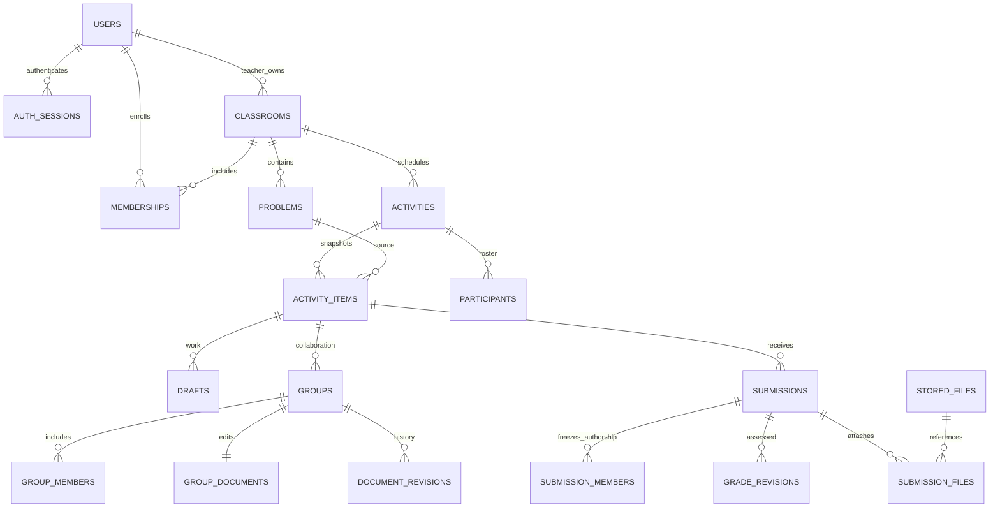
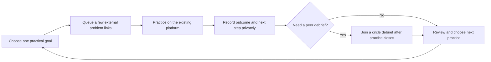
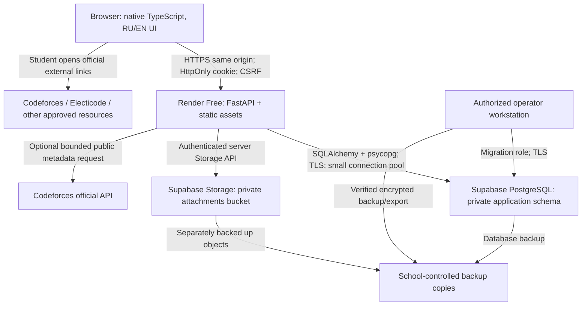
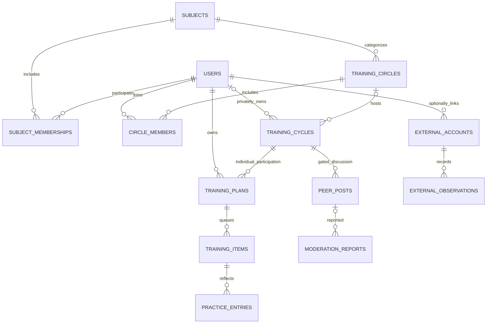
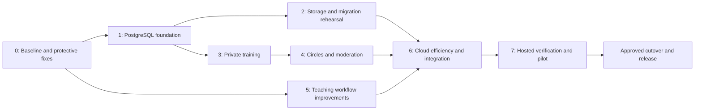

# OlympiadOS V2.0 — Master Product and Engineering Blueprint

**Status:** Planning baseline for a separate, explicitly authorized implementation phase  
**Research date:** 14 October 2026  
**Application audited:** The supplied `OlympiadOS.zip`, not a replacement application  
**Primary decisions:** Preserve the native TypeScript/FastAPI application; use Supabase PostgreSQL and private Storage; retain existing authentication; add a teacher-independent Informatics training cycle; deploy initially as one same-origin Render Free web service, subject to the operational release gates below.  
**Prohibited scope:** No application AI, internal programming judge, unauthorized external integration, production deployment, or cloud-project creation during this assignment.

## How to use this document

Sections 1–6 establish product decisions. Sections 7–8 define architecture and migration. Section 9 is the feature contract. Sections 10–15 specify implementation, operations, and verification. Sections 16–18 define limitations, the final scope, and release gates. Appendix A contains external references; Appendix B identifies the audit evidence. All proposed modules, migrations, commands, and structures are **future implementation deliverables**, unless explicitly described as existing or executed.

### Contents

- [1. Executive Summary](#1-executive-summary)
- [2. Understanding the Olympic Club](#2-understanding-the-olympic-club)
- [3. V1 Source-Code Audit](#3-v1-source-code-audit)
- [4. Informatics Product Research](#4-informatics-product-research)
- [5. The Recommended Informatics Solution](#5-the-recommended-informatics-solution)
- [6. Unified OlympiadOS V2 Product Design](#6-unified-olympiados-v2-product-design)
- [7. Supabase Architecture](#7-supabase-architecture)
- [8. Database Migration Plan](#8-database-migration-plan)
- [9. Complete V2 Feature Specification](#9-complete-v2-feature-specification)
- [10. UI/UX Redesign and Improvement Plan](#10-uiux-redesign-and-improvement-plan)
- [11. Security and Privacy Plan](#11-security-and-privacy-plan)
- [12. Performance and Reliability Plan](#12-performance-and-reliability-plan)
- [13. Free Deployment Blueprint](#13-free-deployment-blueprint)
- [14. Implementation Roadmap](#14-implementation-roadmap)
- [15. Test and Quality Assurance Strategy](#15-test-and-quality-assurance-strategy)
- [16. Risks, Tradeoffs, and Limitations](#16-risks-tradeoffs-and-limitations)
- [17. Final OlympiadOS V2 Scope](#17-final-olympiados-v2-scope)
- [18. Implementation Readiness Checklist](#18-implementation-readiness-checklist)

Evidence labels used throughout:

- **Verified / reproduced:** Directly observed in supplied source or an executed test. A source-level observation is distinguished from runtime reproduction.
- **Risk:** A plausible failure mode requiring targeted testing; not an asserted incident or confirmed exploit.
- **Design decision:** The selected V2 behavior, not a description of V1.
- **Product hypothesis:** An expected benefit to validate with students; no interviews or adoption measurements have been invented.

Source references such as `server/routes/files.py:22–60` refer to the pristine archive. External references `[R01]`–`[R36]` resolve in Appendix A. Service limits are a dated research snapshot, not a promise of future entitlement.

---

## 1. Executive Summary

### 1.1 Assessment of V1

OlympiadOS V1 is a working, thoughtfully engineered school application. Its source contains strict TypeScript, a small FastAPI backend, 32 relational tables, Alembic migrations, durable session authentication, contextual authorization, bilingual interfaces, immutable assignment snapshots, optimistic editing concurrency, idempotent submission handling, manual grading with history, and meaningful security and workflow tests. The frontend is **not React, Vue, or Next.js**. Replacing its framework or rewriting its backend would spend risk and effort without addressing the club’s central problem.

The audit executed 61 backend/security/schema/realtime tests and 16 browser tests through the repository’s existing browser bridge; all passed. TypeScript checking, the frontend build, Python compilation, repeated SQLite initialization, and Alembic drift checking also passed. All 15 shipped JavaScript modules exactly matched a fresh build. Native browser navigation was blocked by the execution environment before reaching the application, and a live PostgreSQL/Supabase integration was not available. These qualifications matter: a bridge is useful evidence, not proof of real hosted-browser behavior.

Three additional characterization probes reproduced gaps beyond the existing suite: a student assigned to an unreleased group can download its attachment when the file identifier is known; a removed classroom member remains included in a later group submission’s member snapshot; and the group comment cap returns the oldest 300 comments, hiding newer ones. The first is a release-blocking confidentiality defect. The others warrant focused fixes, not a wholesale rejection of V1.

### 1.2 The product problem

The existing application organizes learning around teacher-owned classrooms, problems, assignments, and sessions. That is appropriate for Mathematics and Physics. It does not provide an independent operating model for the approximately 60% of club members studying Informatics primarily through external practice and peers. Giving these students an empty teacher-oriented dashboard or a school Codeforces leaderboard does not solve this mismatch.

**V2 should become the club’s preparation and follow-through layer, not another place to solve programming problems.** Its Informatics core will help a student choose a small weekly goal, keep a short queue of external problems, identify what blocked progress, arrange a peer debrief, and decide the next practice step. It must work for a student alone before any peer joins and without an external account connection.

### 1.3 Selected release

The release has four pillars:

1. **Protect and preserve V1:** close verified gaps; retain teacher-led workflows, bilingual authoring, manual assessment, and existing records.
2. **Independent Informatics training:** private plans, external problem links, brief reflection, small student-facilitated circles, and timed spoiler-controlled debriefs. Facilitators receive circle-local capabilities, never teacher or administrator status.
3. **Reliable cloud persistence:** Supabase PostgreSQL plus private Storage, preserving FastAPI and existing Argon2 password hashes. Use a restricted application database role, explicit server authorization, and RLS appropriate to a server-mediated application.
4. **Disciplined operation:** one same-origin deployment, bounded database connections, adaptive synchronization, attachment budgets, recoverable writes, verified backups, and clear free-tier failure behavior.

A bounded, optional Codeforces metadata refresh is a P2 convenience. Electicode remains a link-based resource unless its operator provides a documented, authorized integration. Neither is a dependency of the core experience.

### 1.4 What success means

A Mathematics or Physics teacher can conduct the same complete teaching cycle with fewer administrative obstacles. An Informatics student can complete a useful independent training cycle without a teacher, organizer, or linked platform account. A circle facilitator can coordinate peers but cannot inspect their private reflections or grades. Existing data survive a rehearsed migration. Hosted tests demonstrate confidentiality and recovery, not merely a successful build.

Approximately $0/month is a **best-effort practice deployment target**, not a claim of always-on infrastructure. The school must accept the constraints in Section 13. Critical competitions must not rely solely on a sleeping free service or an untested recovery process.

---

## 2. Understanding the Olympic Club

### 2.1 Distinct learning models

| Dimension | Mathematics | Physics | Informatics |
|---|---|---|---|
| Primary learning relationship | Teacher explains, assigns, reviews, and discusses | Teacher explains concepts and methods, reviews written and diagram-based solutions | Student-directed practice, peer learning, and external training |
| Typical evidence | Written reasoning, proof, intermediate steps | Derivations, diagrams, assumptions, units, reasoning | External attempts and results plus an account of the approach, debugging, and learning |
| Primary platform job | Organize teaching and feedback | Organize teaching and feedback | Coordinate practice and reflection around existing resources |
| Who starts activity | Usually teacher | Usually teacher | Student or voluntary student facilitator |
| Assessment authority | Assigned teacher | Assigned teacher | External platform verdict for code; self-reflection is not an official grade |
| Essential independence | Student can access work and feedback outside lessons | Student can access work and feedback outside lessons | Core workflow must function without an OlympiadOS teacher |

These requirements come from the supplied brief. The outside Informatics training department is independent. No instructor participation, curriculum feed, roster import, account federation, or organizational partnership is assumed.

### 2.2 Consequences for design

Preserve teacher-owned classrooms. Do not weaken their authorization to accommodate Informatics. Add a separate small coordination model whose ownership does not require `Classroom.teacher_id`. Share the application shell, subject vocabulary, accounts, locale, notifications, time handling, and design components rather than forcing every subject into the same activity schema.

Support multiple subjects. V1 already permits a user to enroll in several classrooms, potentially across subjects; V2 must not replace that with one mandatory subject per user. Explicit subject participation is needed for students who have no Informatics classroom. It controls relevant navigation, not access to unrelated classrooms.

Do not assume advanced programmers want teachers to assign their next task. Do not assume beginners can select a productive practice goal unaided. Provide optional, short, human-authored goal examples and links to existing courses; let students choose their level and pace. Avoid inferred skill labels based on a public rating.

### 2.3 Research boundaries and validation

Known: subject mix, learning arrangements, V1 code, and public platform documentation. Unknown: actual club size, grade levels, device mix, internet quality, existing account/data volume, how students currently coordinate, and whether Electicode’s authenticated workflows already satisfy some needs. No live school deployment or student interviews were supplied.

Use a planning workload of **60 students, including 36 Informatics students**, solely for capacity calculations. This is not an asserted enrollment count. Before broad rollout, observe representative students completing a real practice week and ask where planning, seeking help, and following up currently fail. Do not ask students to abandon their existing tools to make a feature appear useful.

### 2.4 Operational ownership

A school-appointed adult owns the school data policy and moderation decisions. The developer maintains software and deployment instructions. A backup custodian and a successor custodian must be named. Facilitators coordinate their own circles; they do not become the school’s unpaid content-production or IT support team. Provider accounts should be institutionally recoverable rather than dependent on one graduating student.

---

## 3. V1 Source-Code Audit

### 3.1 Audit method and preservation

The original archive was hashed and extracted into a pristine audit directory. Execution occurred in a separate copy. The archive contains 132 files and no production SQLite database or student upload corpus. Every extracted file was compared byte-for-byte with its archive entry after inspection: no differences were found.

**Archive SHA-256:**

```text
89cfe734b395bc9be5d8a5c9d7cd5e704b9e8969eb6bb72f7d99623ad01c8d5c
```

Inspection covered application boot/configuration, all route modules, models, schemas, access and serialization services, authentication, uploads, realtime, frontend state/routing/editing/page modules, localization, tests, migrations, deployment files, and supplied screenshots. Screenshot observations describe the supplied examples, not a newly validated hosted rendering. This was not a penetration test of a live school system or a complete dependency-vulnerability scan.

### 3.2 Verified architecture

| Area | Actual implementation and evidence | Assessment / V2 action |
|---|---|---|
| Frontend | Native ES2022 TypeScript modules, strict checking and `noUncheckedIndexedAccess`; `package.json:1–5`, `tsconfig.json:1–9` | Preserve. Add feature modules, not a framework migration. |
| Build | `tsc` produces `static/assets`; no frontend runtime framework or bundler; 15 generated JS modules | Preserve the build; introduce a lockfile and reproducible dependency installation. |
| Navigation/state | Hash routing, render cleanup, dirty-navigation handling; `frontend/router.ts`; small shared state in `frontend/state.ts` | Keep; add subject context and typed training state without a global state library. |
| API | FastAPI routers under `/api`; Pydantic request schemas; structured domain errors; `server/app.py`, `server/schemas.py`, `server/routes/*` | Sound boundaries. Extract new domain services rather than enlarging route functions indefinitely. |
| Persistence | Synchronous SQLAlchemy 2; SQLite default, PostgreSQL dependency option; `server/db.py:9–30`, `requirements-postgres.txt` | PostgreSQL migration is evolutionary, not a new ORM/backend. |
| Schema | 32 mapped tables; one initial Alembic revision; `server/models.py`, `migrations/versions/bb2030abeaf7_initial_relational_schema.py` | Preserve identifiers, constraints, snapshots, and history; add incremental migrations. |
| Authentication | Opaque database-backed sessions, hashed tokens, Argon2id passwords, CSRF token, secure production cookies; `server/security.py:17–82`, `server/routes/auth.py` | Retain. Revoke sessions at cutover; do not move hashes into another identity provider. |
| Authorization | Global roles plus classroom ownership, membership, activity visibility, roster and time checks; `server/services/access.py` | A strength. Add comparable circle-specific helpers and close the file-route inconsistency. |
| Classroom model | One required teacher owner; many memberships; `server/models.py:57–73` | Correct for teaching; unsuitable as the sole owner model for independent Informatics. |
| Activities | One model for assignment/session/competition; immutable item snapshots and server-side phases; `server/models.py:157–194`, `server/routes/activities.py` | Preserve semantics. New training cycles are not graded Activities. |
| Collaboration | Teacher-created groups attached to activity items; whole-document revision CAS, comments, revision history; `server/routes/groups.py` | Useful supervised group work. It is not character-level collaborative editing or a teacher-independent workspace. |
| Submissions/grades | Attempts, request idempotency, group member snapshots, rubric history, explicit release; `server/routes/work.py`, `server/models.py:263–306` | Preserve and extend reliability; never reinterpret an external verdict as a teacher grade. |
| Uploads | Local private files with metadata rows, validation, normalization, quotas, submission associations; `server/routes/files.py` | Good safety primitives; replace local persistence through an adapter. |
| Realtime | Server-Sent Events backed by durable `events` rows; not WebSockets; `server/routes/realtime.py` | Preserve invalidation semantics; reduce cloud query overhead. |
| Localization | Two JSON catalogs; content objects support Russian/English; `frontend/i18n.ts`, `locales/*`, backend i18n | Preserve. Expand complete coverage, not English-only new features. |
| Mathematical/code display | Self-hosted MathJax and Prism; code is text, not executed; `static/index.html`, `frontend/ui.ts`, `frontend/work-editor.ts` | Keep. Lazy-load costly display assets. |
| Deployment | Python 3.13 slim container, non-root user, one Uvicorn process, Docker Compose PostgreSQL option; `Dockerfile`, `compose.yaml`, `scripts/container-start.sh` | Keep container model; change port configuration and privileged migration startup. |
| Tests/CI | pytest, Playwright, workflow/security/schema/SSE tests; a separate PostgreSQL migration CI job; `.github/workflows/ci.yml` | Strong starting point. PostgreSQL CI currently checks migrations, not the full workflow suite. |

Pinned runtime dependencies in the archive include FastAPI 0.128.2, Uvicorn 0.48.0, SQLAlchemy 2.0.50, Pydantic 2.13.5, Alembic 1.18.4, Argon2-cffi 25.1.0, python-multipart 0.0.29, Pillow 12.3.0, and Babel 2.18.0. TypeScript is 5.8.3. These are observed pins, not a declaration that every version is free of vulnerabilities. The PostgreSQL driver uses the broader constraint `psycopg[binary]>=3.2,<4`; lock a verified version during implementation.

### 3.3 Data and trust relationships

V1 timestamps are predominantly UTC epoch milliseconds in `BigInteger` columns. Most IDs are UUID-shaped strings in `String(36)` columns; `events` and `audit_logs` use integer auto-increment IDs. Multilingual content and several snapshots are JSON. Do not introduce simultaneous UUID-type, timestamp-type, JSONB, and naming migrations merely because PostgreSQL supports them.



The diagram summarizes principal links; it is not a replacement for all 32 tables. File target associations are partly polymorphic (`target_kind`, `target_id`) and require application validation. Progress is calculated from activity/submission data; there is no standalone progress table to invent or migrate.

### 3.4 Strengths that must not regress

**Authentication and request boundaries.** Production configuration requires HTTPS origin and a sufficiently long secret. Cookies are HttpOnly and production-secure; mutation requests use CSRF and origin checks. Sessions and rate limits are persistent. Password changes and disabling an account invalidate access. Invitation consumption uses a concurrency-safe update. Evidence: `server/config.py:9–40`, `server/security.py:38–82`, `server/routes/auth.py:20–103`, `server/app.py:62–95`.

**Integrity of learning records.** Assignments snapshot problem content rather than silently changing historical work when the library is edited. Submission retries have an idempotency key and request hash. Draft and group editing use revision comparisons. Grade revisions record assessment history. Competition timing and result publication are server-controlled. Evidence: `server/routes/activities.py`, `server/routes/work.py`, `server/services/access.py:36–107,149–170`.

**Safer uploads and rendering.** The application checks actual upload bytes, rejects unsupported types, normalizes images and strips metadata, keeps local files outside public static paths, and authorizes downloads. PDF responses are downloads with restrictive headers. Text rendering escapes content rather than trusting arbitrary HTML. These do not establish malware-free documents, but they are valuable existing protections. Evidence: `server/routes/files.py:63–142`, `server/app.py:33–59`, `frontend/ui.ts`.

**Resilient editing and localization.** Autosave, local recovery, conflict comparison, retry notices, export, language switching, themes, plural rules, and mobile navigation already exist. V2 should extend their edge cases, not list them as entirely missing. Evidence: `frontend/work-editor.ts:100–328`, `frontend/i18n.ts`, `frontend/app.ts`, `static/styles.css`.

### 3.5 Confirmed findings

| ID | Classification / priority | Finding and exact evidence | Impact and required disposition |
|---|---|---|---|
| A-01 | Reproduced security defect / **P0** | `server/routes/files.py:30–35` applies the activity item gate for a student group write, not read. `can_read_file`, lines 45–60, accepts that target read. `server/services/access.py:126–135` does not itself check release visibility. `/groups/{id}` correctly calls the item gate in `server/routes/groups.py:76–89`. | A currently enrolled assigned group member with a known file ID can download an attachment for an unreleased session item. Close the read-path discrepancy and test every file surface. Not an assertion that unrelated students can enumerate or read all files. |
| A-02 | Reproduced record-integrity defect / **P1** | Classroom removal deletes `Membership` only (`server/routes/classrooms.py:133–139`). New group submission members are taken from `GroupMember` (`server/routes/work.py:73,91–92`). | A removed member is included in a subsequent submission snapshot. Remove current group memberships transactionally and snapshot only active eligible members. Do not rewrite historical snapshots. This reproduction does not demonstrate immediate access by a removed user. |
| A-03 | Reproduced functional defect / **P2, included** | `server/routes/groups.py:86` selects ascending comments with a 300-row limit and no cursor. | After the cap, newer discussion is not returned. Use cursor pagination and a newest-window initial query displayed chronologically. |
| A-04 | Verified product limitation / **P1** | `Classroom.teacher_id` is mandatory; group creation calls classroom write authorization; `Group.activity_item_id` is mandatory (`server/models.py:57–66,206–214`; `server/routes/groups.py:47–74`). | Independent Informatics activity cannot be created by ordinary students through this model. Introduce training circles without loosening teaching permissions. |
| A-05 | Verified deployment mismatch / **P0 migration gate** | SQLite and upload paths are under `DATA_DIR`; `server/config.py`, `server/routes/files.py:115–142`. | Existing default persistence must not be used for the selected ephemeral host. This is a deployment incompatibility, not evidence of data loss in the current school installation. |
| A-06 | Verified administrative limitation / **P2, included** | Adding an existing classroom member is admin-only (`server/routes/classrooms.py:120–130`), while invitation creation rejects an already registered email (`server/routes/auth.py:126–160`). | Teachers cannot independently enroll an existing account through their current invitation flow. Add an email-bound, authenticated enrollment invitation for the teacher’s own classroom. |
| A-07 | Verified client behavior; failure impact is a risk / **P1** | Pending submission request and UUID live only in the editor instance (`frontend/work-editor.ts:283–305`). | A lost success response followed by reload can lose the retry identity. Persist pending intent in per-user session recovery and reconcile by key before creating another attempt. Existing same-instance retry protection must remain. |

**Reproduction record.** A-01 returned group detail `404` and attachment `200`. A-02 showed `Membership` absent while the new `SubmissionMember` still contained that user. A-03 returned 300 comments and excluded the inserted newest comment. All three characterization probes passed when asserting these existing behaviors. They are **not three passing remediation tests**. The initial A-02 probe omitted nonempty group content, received the expected empty-submission validation error, and was corrected in the external audit harness before the final run; no application source was changed.

### 3.6 Risks requiring targeted verification

| ID | Observed mechanism | Risk, not an invented incident | Planned verification / treatment |
|---|---|---|---|
| R-A01 | Synchronous SQL runs inside the async SSE loop every second per connection; `server/routes/realtime.py:42–68` | Cloud latency can block the event loop and multiply reads. The code does close the request’s original connection; do not claim a connection is held for every stream forever. | Load-test hosted-like latency; offload synchronous database work and share bounded event retrieval. |
| R-A02 | Dashboard/progress traverse histories and serialize related entities; `server/routes/progress.py`, `server/services/serialize.py`; library serializes before removing detail fields | N+1 queries and growing histories may dominate latency/egress. | SQL query budgets, representative-year fixtures, bulk projections and pagination. |
| R-A03 | Argon2 uses 64 MiB per verification; image decoding/PNG optimization can be expensive; `server/security.py:17`, `server/routes/files.py:63–104` | Concurrent logins/uploads may exhaust small-host CPU/RAM. | Bound expensive operations separately, do not hold DB connections during hashing/network I/O, measure 60-user arrival and upload bursts. |
| R-A04 | Local file written before final request commit; cleanup around flush only; `server/routes/files.py:115–130`, `server/db.py:23–30` | Commit failure can leave an orphan. Existing CLI cleanup mitigates it; cloud storage adds a second transactional system. | Storage intents, reconciliation, failpoint tests, global reservations. |
| R-A05 | Per-user quota is 200 MiB; no shared cloud budget; `server/config.py`, `server/routes/files.py:105–114` | Several valid users can exceed the chosen project storage budget. | Global budget, reserved capacity, compression, retention and quota display. |
| R-A06 | PDF validation checks signatures/end marker, not document safety | Malicious PDF contents could still be downloaded and opened by a user. | Preserve forced download, reject active web formats, communicate limits; consider school-managed scanning only when genuinely available. |
| R-A07 | Realtime/client fallback operates broadly while signed in; `frontend/app.ts` | Unnecessary hidden-tab traffic and notification refreshes consume capacity. | Subscribe only where needed, pause hidden-tab work, jittered backoff and bounded polling. |
| R-A08 | Runtime startup invokes database initialization; fixed Uvicorn port; `scripts/container-start.sh:1–7` | Host startup may require privileges that should not be present in the app, and port binding must match the provider. | Separate migration job/runbook; configurable `$PORT`; schema readiness check. |
| R-A09 | Revision history is append-only; basic CLI retention covers only selected ephemeral records; `server/cli.py` | Full-document snapshots can fill a small database over a school year. | Measure growth; compact only unreferenced editing revisions using the retention contract. |
| R-A10 | Existing browser tests need a bridge in this environment; PostgreSQL workflow tests not executed | Hosted cookie/CSP/module loading, real Postgres concurrency, and Storage behavior remain unverified. | Release-blocking native-browser and live staging matrix, not a documentation disclaimer alone. |

### 3.7 Functional audit by user and feature

| Capability | V1 state | Keep / change |
|---|---|---|
| Accounts and onboarding | Invitation registration, roles, locale/theme, profile and password changes; admin enable/disable; operator reset CLI | Keep; add subject enrollment and a discoverable school recovery procedure. No public self-promotion or obligatory email provider. |
| Dashboards | Teacher/student information, subject cards, due work and announcements | Keep visual system; prioritize next actions and distinguish teaching from self-training. |
| Classrooms | Teacher-owned rooms, membership, resources, announcements, archiving | Preserve for Mathematics/Physics and any existing Informatics classrooms. Add safer existing-user enrollment and offboarding. |
| Problem library | Multilingual problems, Unicode-normalized search, tags, difficulty, attachments, version checks | Preserve; use lean list projections, better filters, and release-aware attachment tests. |
| Sets and assignments | Reusable sets; creation/publish/control paths; stable item snapshots | Preserve; add limited safe draft editing and cloning rather than replacing activity architecture. |
| Live practice | Release items/hints/solutions, help requests, presentation view, server time | Preserve; improve connection status and instructor readiness controls. |
| Group work | Teacher-created activity-bound groups, revisioned text, comments and sharing | Preserve; fix membership/comment issues. Do not market it as simultaneous character-level editing. |
| Submissions | Individual/group attempts, attachments, idempotency, private access | Preserve; make interrupted submission outcomes recoverable across reload. |
| Review and feedback | Manual rubric assessment, history, release control | Preserve; improve queue filters and visible revision requests. No automated/AI grading. |
| Mock Olympiads | Individual roster, deadlines, hidden material/results, teacher publication | Preserve exact rules; add outage procedure and reconnection tests. No internal code execution. |
| Progress | Derived completion/score information based on visible learning records | Preserve teacher metrics; keep Informatics reflection separate and explicitly self-reported. |
| Notifications | Private in-app notifications and read markers | Preserve; group related updates and avoid external email/push dependencies. |
| Administration | Accounts, invitations, settings, audit display; CLI maintenance/recovery | Keep; add circle moderation, quotas, backup status and export/retention tools. |

For teachers in either Mathematics or Physics, the application already supports the essential end-to-end instructional loop. Physics benefits especially from reliable image/document handling; Mathematics from proof-oriented editing and mathematical rendering. Both need dependable review and release behavior more than a new interface framework.

For Informatics students, existing code-format problems and Python/C++ text editing do not amount to an independent training model. Teacher-created Informatics activities must continue to work, but they should no longer be the prerequisite for useful participation.

### 3.8 Executed checks and limitations

| Check | Result | Qualification |
|---|---|---|
| Isolated dependency installation | Blocked by package-index DNS resolution | No successful clean installation claimed. Existing runtime versions matched the pinned application/test dependencies used. |
| `npm run typecheck` | Passed | Existing TypeScript 5.8.3; no new package installation. |
| `npm run build` | Passed | All 15 shipped JS modules matched rebuilt output. |
| `python -m compileall -q server` | Passed | Syntax/import compilation, not behavioral verification. |
| Security, workflows, i18n/schema, realtime pytest modules | **61 passed**, 14.75 s | Isolated SQLite-backed tests. |
| Native Playwright run | Environment-blocked | First navigation failed with `net::ERR_BLOCKED_BY_ADMINISTRATOR` at localhost; stopped after that failure. |
| Existing `BROWSER_BRIDGE=1` Playwright suite | **16 passed**, 86.21 s | Real DOM and local API/database interactions, but bridge substitutes browser transport/storage and module bootstrap. |
| Additional audit characterization probes | **3 passed**, 1.33 s | Reproduce A-01/A-02/A-03, not fixes. |
| SQLite CLI initialization twice | Passed | Demonstrated repeatable initialization on an isolated database. |
| `alembic check` after initialization | Passed | No model/schema drift detected on SQLite. |
| PostgreSQL dialect DDL compilation | Passed, 64 table/index statements | Offline compiler only; no PostgreSQL connection or constraints executed. |
| Archive and pristine-tree preservation | Passed | 132 files unchanged; archive hash recorded. |
| Live PostgreSQL, Supabase, Render, Codeforces API calls | Not executed | Public documentation researched; no authenticated provider configuration, deployment, real cloud integration, or external data synchronization performed. |

The original CI’s PostgreSQL job runs initialization twice and `alembic check` (`.github/workflows/ci.yml:31–57`). Its presence is evidence of intended support, not proof that the complete security and workflow suite passed against PostgreSQL here. No coverage percentage, performance benchmark, security certification, or production data migration is claimed.

---

## 4. Informatics Product Research

### 4.1 Existing tools already solve substantial parts of the problem

Codeforces documents machine-readable problem/submission/contest-related data and account activity methods. It is an existing practice and competition environment; OlympiadOS should keep actual problem solving and submission there. Its individual-contest rules also constrain when peer discussion is appropriate. [R01], [R02], [R03], [R04]

Electicode’s public pages advertise programming education, practice, contests, and progress-related capabilities, including school/class use. Its public course listing includes introductory programming and staged Olympiad preparation, and its resources page provides learning material. The developer’s own product description also presents educational and classroom functionality. These are public product claims; authenticated behavior, school licensing, export capability, and the club’s actual usage were not tested. [R05], [R06], [R07], [R08]

USACO Guide already offers a curated preparation roadmap and practice resources. Its practice guidance discusses choosing suitable problems, focused improvement, and reflecting on unsuccessful attempts. This is practitioner-authored guidance, not experimental proof that a particular OlympiadOS feature will raise contest results. [R09], [R10]

**Consequence:** A new curriculum, generic problem tracker, classroom contest feature, or tutorial library is not automatically an unmet need. The relevant opportunity is the school-specific gap between external practice and sustained local coordination.

### 4.2 Candidate unmet needs: hypotheses, not interview findings

| Hypothesis | Why it matters in this club | What would disprove or weaken it |
|---|---|---|
| Students struggle to turn broad intentions into a manageable practice week | Independent training lacks the teacher’s routine assignment structure | Most students already use an effective personal workflow and would not switch |
| A failed attempt is abandoned rather than revisited | A verdict alone does not record the student’s next learning action | Existing Electicode/Codeforces routines already trigger productive follow-up |
| Peers willing to help cannot easily coordinate topic, time, and spoiler boundaries | The school has a local peer community without formal external-teacher integration | Current in-person/chat coordination is easy and sufficient |
| Beginners and advanced students need different entry points into the same community | A single rating-oriented board can favor already-successful students | Students prefer entirely separate cohorts and no common coordination |
| Valuable practice insights disappear in unstructured chat | A brief retrievable reflection may improve continuity | Recording reflection feels like paperwork and does not change next practice |

The design must make these hypotheses cheap to test. It must not depend on inventing a content team or asking every student to log every minute.

### 4.3 Strategy comparison

Ratings below are qualitative planning judgments derived from the brief and product inspection, not measured survey results. “High feasibility” means lower implementation risk.

| Evaluation | A. External statistics and school ranking | B. School curriculum / extensive algorithm notebook | C. Small training cycles and peer debriefs | D. Minimal links and club noticeboard |
|---|---|---|---|---|
| Student value | Uneven; convenient visibility for some, little next-action help | High only if local content adds something unavailable elsewhere | Potentially high: closes planning/help/follow-up gaps | Modest but immediate |
| Expected frequency | After contests or occasional curiosity | Weekly if content is consistently maintained | Before practice, after a meaningful attempt, and at weekly review | Around announcements or events |
| Educational benefit | Weak causal connection; rating is not a learning diagnosis | Potentially strong, but duplicates established material | Plausible improvement in follow-through and explanation | Mainly organizational |
| Technical feasibility | Medium: external dependencies and identity ambiguity | High for basic pages, lower for rich authoring/progress | High for bounded relational workflows | Very high |
| Implementation complexity | Medium | High when content paths, prerequisites and exercises expand | Medium; reuses shell/auth/components but adds a separate domain | Low |
| Maintenance | API changes, profile errors, metric disputes | Continual expert curation and translation | Moderation and occasional goal examples; no mandatory curriculum | Low |
| Existing-platform compatibility | Complementary data, but risks duplicating existing profile pages | Significant duplication of Electicode/USACO Guide | Strong: external platforms remain the practice environment | Strong |
| Infrastructure cost | Small initially; synchronization can grow | Small for text, higher for media and large imports | Small and controllable; manual core has no API cost | Minimal |
| Long-term sustainability | Novelty and competition effects may fade | Depends on unavailable sustained expert contribution | Good if the loop is useful individually and facilitator effort stays low | Sustainable but limited impact |
| Privacy / inclusion | Public rankings can expose minors and discourage beginners | Less ranking risk, but substantial learner profiling possible | Private by default; no ranking required | Low exposure if club-private |
| Decision | Reject as the primary strategy; keep only optional evidence refresh | Reject as the V2 centerpiece | **Select** | Reuse existing announcement/resource primitives rather than a separate product |

### 4.4 Why strategy C wins—and its limits

The chosen strategy targets something the school can actually own: local routines, peer relationships, and continuity. It does not compete on judging, problem supply, comprehensive courses, or public ratings. It works when only one student uses it; the private plan is useful before a circle develops. Peer coordination adds value without requiring external instructors.

The main risk is administrative friction. Therefore, logging must be optional and brief: a student can add a link, mark “revisit,” and record one next step without writing an essay. The application must not reward empty activity, streak maintenance, or total solved counts. A circle should coordinate a concrete practice/debrief, not become another always-on chat stream.

A modest noticeboard is the baseline alternative, not an inferior option by definition. When pilot evidence shows a proposed workflow duplicates an already effective habit, remove that workflow rather than forcing adoption. A small useful release is better than a large empty training portal.

### 4.5 External integration findings

**Codeforces.** The documented API allows at most one request every two seconds and returns an `OK`/`FAILED` envelope. Methods include `user.status`, `user.info`, `user.rating`, and contest/problem-related reads. Submission results are ordered by descending submission ID. Current documentation includes an `includeSources` option restricted to the requesting account; V2 will not request source code, private credentials, or that option. Problem metadata is not a license to mirror complete statements/editorials. [R01], [R02], [R03]

**Electicode.** No supported public API or export contract was located in the reviewed public product/course/resource/developer pages and targeted public searches. This is a bounded negative finding, not proof that no private or future integration exists. V2 will store student-supplied links and manual progress notes. No login automation, internal endpoint reverse engineering, browser scraping, or assumed access to the external department is part of scope. [R05], [R06], [R07], [R08]

### 4.6 Validation plan

Run a four-week pilot with roughly 10–12 volunteers representing beginner/intermediate/advanced Informatics and both interface languages. Include students who do not connect Codeforces and at least one multi-subject student. These are proposed participants, not people already interviewed.

Before the pilot, observe one actual planning/practice/debrief cycle using current tools. During it, ask participants to use OlympiadOS only where it replaces a real coordination or follow-up step. At the end, inspect whether their next practice action changed, rather than asking only whether they liked the interface.

Provisional success gates: at least 60% of participants who complete onboarding return for a meaningful training action in week four; at least half complete a goal→attempt/reflection→next-step cycle; the median weekly logging burden is under five minutes; facilitators can organize a recurring practice without administrator intervention; no privacy or contest-integrity incident is unresolved. These thresholds are decision aids to revise after a baseline, not promised outcomes or student performance requirements.

---

## 5. The Recommended Informatics Solution

### 5.1 Product concept: “My training” and small training circles

The core loop is:



A **training cycle** is a small bounded preparation period, normally one week. It can be private or belong to a circle. A **plan** is one student’s goal and short item queue within that cycle. A **practice entry** records an outcome, assistance used, a brief reflection, and a next step. A **circle** is a small opt-in peer group with a student facilitator; it is not a classroom, teacher, or permission to grade.

### 5.2 Core workflow and exact behavior

**Start.** The student opens “My training / Моя подготовка,” chooses or writes a goal, and optionally adds one to five links. The initial screen offers examples such as “explain binary-search invariants” or “revisit two unfinished graph problems,” not an automatically assigned curriculum. A goal may be in Russian or English; adding both translations is optional.

**Practice.** Links open the official external site in a new tab with safe link attributes. OlympiadOS does not fetch arbitrary URLs, embed judges, collect external passwords, or claim the external page is available. A manual title is enough when metadata is absent. External downtime never prevents editing the plan.

**Reflect.** The student chooses `not_started`, `attempted`, `revisit`, or `completed` for the item. “Completed” is a self-reported planning status, not proof of an independent accepted solution. An optional assistance category distinguishes independent work, hints, editorial study, and peer help. Reflection prompts are short: “What blocked me?”, “What changed?”, “What will I try next?” Blank reflection is allowed.

**Request a debrief.** In a circle cycle, the student may post a short help request or explanation only under the cycle’s visibility rules. Their private plan and entries are not automatically shared. Sharing creates an explicit, limited post; it does not grant access to the underlying private record.

**Review.** At cycle close, the student sees their chosen goal, queued items, unfinished/revisit items, and next-step notes. Carrying an item to another cycle creates a reference/copy with clear provenance, not an alteration to history. There are no penalties for an unfinished week.

### 5.3 Circles and facilitator capabilities

Initially, an active Informatics participant may create up to two active circles; a circle allows at most 12 active members. These are application limits for manageable moderation, not provider limits. Creation is enabled by a club setting and may be temporarily disabled by the administrator without disabling private training.

The creator becomes a facilitator for that circle only. A facilitator can edit circle details, propose/publish cycles, approve an opt-in join request, remove membership, transfer facilitation to a willing active member, and hide a disruptive post pending moderation. They cannot invite strangers into the school account system, enumerate emails, change global roles, read private plans, inspect submissions/grades, or create teacher-owned activities.

Membership requires an authenticated school account and active subject participation. Joining is explicit; no student is silently added to a peer group. A circle may be discoverable within Informatics by name, topic and safe description, but membership lists and posts remain restricted. Invitation links carry no private roster or student information. Removal blocks subsequent circle access immediately at API checks. Leaving a circle does not delete the student’s private plan or erase authorship history. The former member can read/export their own retained plan through My training using its creation-time context snapshot, without reading current circle data. That old circle plan becomes read-only; further work can be carried into a new private cycle.

At least one facilitator must remain, unless an administrator archives the circle. A facilitator cannot transfer responsibility to a disabled or non-consenting account. Administrators can lock a circle, handle reports, and revoke facilitation without assuming teacher ownership of all learning activity.

### 5.4 Practice modes and integrity

A published circle cycle declares one of two modes:

| Mode | During practice | After the declared practice end |
|---|---|---|
| Individual practice followed by debrief | Published problem links, structured logistics and the student’s own work; all freeform peer posts are unavailable, including posts labeled logistics | Debrief posts become available when server time reaches the gate |
| Collaborative study | Explicitly labeled collaboration; peer explanation is allowed | Discussion continues until archive/close |

There is no assertion that OlympiadOS can prevent communication through other websites or messages. External contest rules remain authoritative. Codeforces’s individual-contest restriction on sharing ideas/code makes that distinction important. [R04]

A timed individual cycle requires a server-validated `discussion_opens_at` not earlier than `practice_ends_at`. Once practice starts, facilitators cannot move the gate earlier; extending it is allowed with an audited notice. Administrative correction requires a reason. An active official OlympiadOS competition continues to apply the existing conservative collaboration/material lock to the participating student, including the new peer-discussion surfaces. External live contests cannot be detected perfectly; students and facilitators must declare applicable restrictions, and links must not imply permission to collaborate.

Once individual practice starts, the published guidance and shared problem-link list are frozen. Permitted logistics changes are structured time/status changes or a preconfigured school location, not a new freeform text channel. The application must enforce gates on read APIs, posts, notifications, exports and event payloads—not simply hide tabs. Pre-debrief notifications must not reveal post text or spoiler metadata. V2 will not create a second internal grading system for these cycles.

### 5.5 Three realistic scenarios

**Beginner studying alone.** A student studying an Electicode introductory course selects “implement loops without off-by-one errors,” adds two course/problem links, and marks one for another attempt. They record a one-sentence explanation after practice and carry the unfinished item forward. No teacher, circle, Codeforces account, or imported curriculum is needed.

**Mixed-level peer group.** Six students form a circle around graph traversal. A facilitator schedules individual practice followed by a school debrief. Each student selects an appropriately challenging external problem. After the gate opens, one student shares a minimal counterexample and another explains a visited-state mistake. Neither student’s private notes or unrelated activity becomes visible. The facilitator schedules the next cycle without administrator action.

**Advanced student with external training.** A student receives work from the independent department and stores a personal reminder/link without uploading restricted materials or assigning tasks to those instructors. They identify an unfinished problem to revisit and opt into a local discussion only where external rules allow it. OlympiadOS coordinates the school-side follow-through without claiming an institutional integration.

### 5.6 Optional Codeforces evidence refresh

This is **P2, included as a separately switchable enhancement**, never a dependency of private plans, circles, or release of the core. The feature is deliberately smaller than a synchronization platform.

A student may enter a public handle, consent to the specific metadata read, and request a refresh. Handle ownership remains **unverified**; a successful lookup proves that the handle exists, not that it belongs to the student. Do not display a verified badge, use it for school selection, or publish rankings.

The first implementation performs one bounded `user.status` read of up to 100 recent submissions. It retains only observations relevant to that student’s linked Codeforces items: external submission ID, problem identifier, observed verdict, external creation time, and observation time. It does not ingest names, avatars, friends, source code, full histories, ratings, or problem/editorial text. No API key is required for the selected public-data workflow. [R01], [R02], [R03]

**Engineering contract:** use a fixed Codeforces host and method; URL-encode the handle; bound response size and timeout; respect a global minimum 2.2-second reservation interval; allow at most one successful fresh request per linked user per six hours; show stale-cache timestamps. The 2.2-second margin and six-hour cache are application choices. A database-backed atomic reservation coordinates concurrent application requests. When busy, return a localized `429` with `Retry-After`; do not hold a transaction while sleeping. No dedicated worker or continuously running scheduler is required.

API `FAILED`, rate limiting, unavailable service, invalid handles, malformed responses, and verdict changes must not change the student’s self-reported reflection. A successful observation is offered for confirmation, not automatically converted to completion or proof of independent work. Repeated recent-window reads are deduplicated by provider/account/submission ID. The UI explicitly says “recent observations, not a complete history.” Requests never use `includeSources`.

Disconnecting removes the handle and stored observations, leaves manually authored plans/notes intact, and prevents further calls. External metadata is private by default. Tests use fixtures and a mock transport; a later explicit staging smoke test verifies the public contract without scraping.

### 5.7 Educational value without surveillance

The platform measures continuity of preparation, not student worth. It should show “three items marked for another attempt” rather than “you are behind your classmates.” Circle summaries may show willing participants and the debrief agenda, not private unsuccessful attempts. Staff pilot reporting uses a small aggregate count of completed cycles and reported friction; no keystroke monitoring, covert time tracking, or public league table is introduced.

---

## 6. Unified OlympiadOS V2 Product Design

### 6.1 One application, two appropriate learning patterns

Keep one account, one shell, one profile, one notification center, one language switch, and one visual system. Use subject context to prioritize actions while retaining access to all the user’s authorized spaces. Do not maintain two independent apps or add a mandatory “Informatics teacher” account.

Primary navigation becomes **Home, My work, Spaces, Library, Progress**. Notifications remain a shell action; Profile and Help sit in the account menu. Teachers gain Review and their existing management actions. Administrators gain Administration. Existing deep hash links redirect to their equivalent screens rather than breaking notification/bookmark URLs.

“My work” includes assigned tasks and, for Informatics participants, the current training plan. “Spaces” presents teacher classrooms and training circles as visibly distinct cards using a shared layout. The library retains authorized classroom material and a small external-link entry point; it does not become a mirrored programming archive.

### 6.2 Dashboard priorities

| User context | First useful action | Secondary content |
|---|---|---|
| Mathematics/Physics student | Continue due work or read newly released feedback | Next classroom session and relevant announcements |
| Informatics student without classrooms | Continue a private plan, choose the next item, or join an upcoming debrief | Circle activity and a small set of approved external starting links |
| Student in several subjects | Due assigned work and current self-training, labeled by subject | Subject filter and upcoming activities across memberships |
| Teacher | Review pending work, prepare next session, respond to help | Class activity and announcements |
| Administrator | Outstanding moderation/operational issues | Account/invitation and quota/backup controls |

An empty state must give a valid next action. “No assignments” is not an appropriate primary welcome for a student whose subject does not depend on teacher assignments.

### 6.3 Shared primitives and boundaries

Reuse bilingual content rendering, dates/timezone display, typed API errors, confirmation dialogs, form validation, badges, cards, notifications, and access-denied behavior. Keep `Activity`, teacher `Group`, and `Submission` intact. Add `TrainingCircle`, `TrainingCycle`, and private planning records with their own access helpers. Share editor utilities only where semantics match; do not force a private reflection into a graded submission.

Subject participation is a separate many-to-many record. Migration derives it from existing classroom memberships, then administrators can invite a student into a subject without creating a classroom. Students may manage which participating subjects are prominent in navigation, but cannot self-assign school staff permissions or enroll in private classrooms through that preference.

### 6.4 Teacher experience improvements

Improve the review queue with classroom/activity/status filters and a clear “revision requested” state. Add safe draft editing and cloning for assignments/sets, retaining immutable snapshots once published. Allow teachers to send enrollment invitations for existing school users without global account browsing. Show connection status, last save, and server-authoritative deadlines consistently. Preserve manual grading and the teacher’s ability to provide content in either or both languages.

### 6.5 Design restraint

V2 does not add general direct messaging, public profiles, arbitrary file uploads to peer circles, a school social feed, a calendar synchronization platform, or a full algorithm knowledge base. Peer discussion stays attached to a purposeful cycle. Existing classroom collaboration remains available. This keeps the system coherent and reduces the surface that staff must moderate.

---
## 7. Supabase Architecture

### 7.1 Alternatives and decision

| Criterion | A. FastAPI + Supabase PostgreSQL only | B. FastAPI + PostgreSQL + selected Supabase services | C. Rebuild around browser-facing Supabase services |
|---|---|---|---|
| V1 compatibility | Very high | Very high when authentication and API semantics stay intact | Lower: session, permission, realtime and workflow changes |
| Migration risk | Low for database, unresolved file persistence on chosen host | Moderate, bounded database/object migration | High combined data/auth/API migration |
| Security work | Existing server checks plus database credentials | Same plus explicit private-object gateway | Full browser RLS policy model and identity migration |
| Hosting fit | Needs another durable file store | Good fit for the selected stateless backend | Potentially fewer backend operations, but complex domain actions remain |
| Realtime | Existing SSE | Existing SSE initially; Supabase Realtime optional later | Must redesign authorization and client subscription model |
| Maintenance | Small backend, another storage decision still needed | Small backend plus one object adapter | More changed code and dual transition paths |
| Decision | Incomplete for the selected deployment | **Selected** | Reject for V2; no user-value justification for the rewrite |

**Architecture B is definitive:** retain FastAPI, SQLAlchemy, existing opaque-session authentication, and the native TypeScript frontend; migrate relational persistence to Supabase PostgreSQL; store attachments in a private Supabase Storage bucket; retain and optimize the existing event protocol. Do not adopt Supabase Auth, Edge Functions, or Realtime solely because they are available.

### 7.2 Deployment and trust diagram



Only the backend knows database credentials and the Storage server secret. The browser receives neither. The operator’s migration credential is absent from the web-service runtime. There is no browser-to-database route in the selected architecture.

### 7.3 Database connection contract

Use the Supabase **session pooler** for the initial IPv4-compatible persistent backend. Copy the exact host and role-qualified username from the project’s connection information; do not synthesize pooler names from regions. Session mode uses port 5432. Direct connections are appropriate where IPv6 is actually supported; transaction mode is a different option with prepared-statement/session-state restrictions and is not the initial configuration. [R13]

Initial SQLAlchemy settings: `pool_size=2`, `max_overflow=1`, `pool_timeout=10`, `pool_pre_ping=True`, and one web process. These are conservative starting values to validate, not claims about the provider’s maximum connection count. Keep each transaction short. Do not hold connections during password hashing, image conversion, outbound HTTP waits, event stream lifetimes, or user interaction. Include administrative/migration connections in the total budget.

Require TLS with certificate and hostname validation. The preferred configuration is `sslmode=verify-full` with the documented CA trust material. `sslmode=require` provides encryption but should not be described as equivalent to verified server identity. Validate the exact session-pooler endpoint and certificate chain during staging. [R33]

Use statement and lock timeouts appropriate to the route: interactive transactions should fail with a localized retriable error rather than wait indefinitely. Migration timeouts are configured separately. Database unavailability returns a stable service-unavailable error; the application never silently falls back to a fresh local SQLite database in production.

### 7.4 Schema and role separation

Create a dedicated `olympiados` application schema. Keep Supabase-managed `auth`, `storage`, and other platform schemas under platform management. Existing table names and IDs remain unchanged inside the application schema. The implementation must configure model metadata, Alembic version-table placement, foreign-key resolution, and SQLite schema translation consistently; a test must fail if an application table is accidentally created in `public`.

Use two database identities:

| Identity | Permitted | Not permitted |
|---|---|---|
| Migration/operator identity | Bootstrap schema, migrations, grants/policies, controlled import/export | Embedded in frontend or regular web-runtime environment |
| `olympiados_app` runtime role | Explicit DML on application tables and required sequence access | Superuser, `BYPASSRLS`, schema/table ownership, DDL, role creation/grants, access to unrelated managed data |

Do not expose `olympiados` through the Data API. Revoke schema/table/sequence access from `PUBLIC`, `anon`, and `authenticated`; disable unused Data API access where the platform configuration supports it. New tables must receive the same restrictions via migration assertions, not an assumption about dashboard defaults. Supabase documents that privileged roles/keys can bypass row policies; the application must not confuse a browser policy with a server-side permission check. [R14]

### 7.5 The exact RLS responsibility model

**Selected model: server-authorized application with RLS blocking direct browser access—not per-student database RLS.**

Enable RLS on application tables and force it where appropriate. Create explicit policies allowing the dedicated runtime role its intended backend DML. Browser roles receive no application-table policies or grants. The migration role is kept separate. This avoids pretending that `auth.uid()` identifies a V1 session: V1 users are not Supabase Auth users.

The runtime role’s policy necessarily permits backend access across application users. Therefore, **RLS does not prevent a buggy FastAPI route from reading another student’s row.** `Actor`, contextual access services, scoped SQL queries, output DTOs, and authorization regression tests are the per-user security boundary. This is an intentional architecture choice. It is simpler and less error-prone for V2 than introducing a second session-to-database identity system during migration.

Policies that set `USING (true)` for the runtime role must be documented as backend-only allowances, never advertised as row isolation. Test direct SQL as each role, Data API requests as anonymous/authenticated roles, and every backend route as disallowed users. Keep all SQL parameterized. A later per-user transaction-context RLS design requires a separate threat model, connection-reuse tests, and an explicit migration decision; it is not silently implied here.

### 7.6 Authentication

Retain V1’s `users`, `auth_sessions`, invitation flow, Argon2 hashes, CSRF, and same-origin session cookies. Do not import these hashes into Supabase Auth. Retaining the same application verifier is the compatibility strategy. Validate representative legacy hashes with test accounts and preserve the stored hash strings unchanged during import.

At cutover, invalidate all sessions and outstanding invitation links, rotate the application secret deliberately, and require a fresh login. Existing passwords remain valid unless a specific account requires recovery. Provide bilingual communication explaining the new address and login requirement. Never send passwords or ask for Codeforces/Electicode passwords.

Keep the existing operator reset command available through a secured workstation using the application’s supported database configuration. V2 adds a documented identity-verification and one-time recovery process, not an unauthenticated reset endpoint. Hosted SMTP and a third-party email service are not core dependencies.

### 7.7 Private Storage and the file gateway

Use one private bucket, `olympiados-attachments`, for existing classroom/problem/resource/draft/group files. Peer training circles initially use links and text only. Store objects under random opaque keys such as `files/<stored_file_id>`; never embed names, emails, grades or problem answers in object paths.

Private buckets do not expose ordinary public retrieval. Storage access rules and server keys are distinct from application authorization; server service credentials can bypass Storage RLS. Consequently, the FastAPI file gateway must authorize the current user before every retrieval. [R15], [R16] Retain V1’s legitimate immutable-submission attachment fallback: access may derive from an authorized current parent or an authorized `submission_files` association checked with `submission_access`. The A01 fix closes the unguarded group-parent branch; it must not remove valid historical submission access.

**Initial delivery choice:** keep `/api/files/{id}` as an authorized proxy that streams object bytes through FastAPI. Preserve `private, no-store`, `nosniff`, forced PDF/text download, and restrictive content headers. Images may be displayed inline after safe normalization. This preserves revocation/release semantics and avoids public signed links in V2’s main workflow. It does consume both storage-origin and backend outbound traffic; Section 13 budgets for this explicitly.

Do not call an 8 MiB object “small enough to buffer repeatedly.” Upload validation can use bounded temporary storage; download must stream with backpressure and close upstream responses on cancellation. Ephemeral disk is acceptable for temporary processing, never as the only copy of accepted work. A signed-URL optimization is deferred until privacy, lifetime, revocation tolerance, content headers and bandwidth justify it.

Use the supported server Storage API behind a narrow `StorageBackend` interface with `put`, `open_read`, `stat`, and `delete`. Prefer a small, pinned HTTP client using documented endpoints rather than adding an entire new authentication/client framework. Pin and contract-test the chosen authentication header/key mechanism during implementation; current server secret handling must never be guessed from browser examples.

### 7.8 Upload transaction protocol

Database and object storage cannot be committed atomically. Implement an explicit state machine:

```mermaid
stateDiagram-v2
    [*] --> reserved: authorize and reserve bytes/slot
    reserved --> uploading: validate and upload opaque object
    uploading --> ready: verify object and commit StoredFile
    reserved --> failed: validation/permission failure
    uploading --> failed: upload/verification failure
    failed --> cleaned: remove object and release reservation
    ready --> deleting: authorized delete; no immutable references
    deleting --> cleaned: object deletion confirmed
```



A request carries an upload idempotency key. A short transaction checks user, classroom/item visibility, per-target count, per-user budget and global budget, then reserves capacity. Expensive validation/upload occurs outside the transaction. Before finalization, re-check active account, scope membership, time gate and target availability; a student removed during the upload must not finish writing to a revoked scope. Commit `StoredFile` only after the object is verified; finalize reservation accounting in the same transaction.

A retry with the same key reconciles the same intent instead of creating another file. File size and SHA-256 refer to the normalized stored bytes. Failed/abandoned intents are reconciled with a grace interval and logged. Concurrent users uploading to one group must share the target-slot constraint, not only a per-user lock. Files referenced by immutable submissions remain protected from deletion.

### 7.9 Realtime decision

Do not add Supabase Realtime to V2’s required path. The application already has privacy-scoped durable invalidation events and browser handling. Supabase Realtime would add another authorization/token path without removing the need for current HTTP checks.

Keep SSE only while a user is in an active live session or group workspace. Outside these screens, use bounded foreground polling for notification counts and relevant changes; pause in hidden tabs. Move synchronous database operations out of the async event loop. Use a shared, bounded per-process retrieval of candidate event IDs rather than scanning the same global stream independently every second for every idle user. Perform current authorization before emitting each event; do not broadcast a prefiltered result across users.

Keep event payloads small: kind, entity ID, server time, and cursor—not submission text, private reflection, comments, or grades. Reconnection refetches authorized canonical state. When a cursor predates retained events, send a reset instruction. On logout, revocation, removal, or competition lock, close or restrict the stream promptly. API authorization remains immediate even if a status indicator takes a few seconds to update.

Supabase Realtime is a future measured alternative, not a prohibited technology. It should be reconsidered only when a prototype proves lower operational cost and equivalent privacy with the retained authentication model.

---

## 8. Database Migration Plan

### 8.1 Principles and migration units

Treat migration as three coordinated deliverables: **relational data**, **attachment objects**, and **operational/authentication configuration**. A successful row import without working attachments, permissions, sessions, and rollback is not a completed migration.

Keep the original Alembic baseline immutable. Add new revisions for schema configuration, fixes, V2 structures, constraints and indexes. Use a migration ledger containing source snapshot ID, archive/backup hash, schema version, row counts, attachment manifest hash, verification results, operator, and cutover time. The archive has no real production dataset, so actual row/file counts and legacy anomalies remain pre-migration inputs.

### 8.2 Existing 32-table preservation map

| Migration group | Existing tables | Treatment |
|---|---|---|
| Identity and club configuration | `users`, `subjects`, `topics`, `club_settings` | Preserve IDs, roles, active flags, locale, names, password hashes, timezone and content. Validate role/locale/timezone values before import. |
| Enrollment and teaching spaces | `classrooms`, `memberships` | Preserve owners, subject links, archives and memberships. Report orphan/disabled-owner cases; do not assign a new teacher silently. |
| Learning material | `announcements`, `resources`, `problems`, `problem_sets`, `set_items` | Preserve multilingual JSON, search text, order, links, versions, attachments and publication state. Recompute search text only as an explicit verified migration step. |
| Activities and release control | `activities`, `activity_items`, `participants`, `help_requests` | Preserve schedules, durations, rosters, snapshots, rubrics, points and release/result flags. Never rebuild historical snapshots from the current library. |
| Collaborative work | `groups`, `group_members`, `group_documents`, `document_revisions`, `group_comments` | Preserve documents/history. Remove only invalid current memberships under a reported repair policy; retain past authorship and submission snapshots. |
| Work and assessment | `drafts`, `submissions`, `submission_members`, `grade_revisions` | Preserve content, language, attempts, client IDs, request hashes, group revision, member snapshots, scores, criterion scores, feedback and release state. |
| Attachment metadata | `stored_files`, `submission_files` | Preserve metadata IDs and associations. Add object key/checksum/state metadata after object verification. Missing files block cutover unless explicitly quarantined and acknowledged. |
| Operational records | `notifications`, `audit_logs` | Preserve outstanding notices and audit history within approved retention. Existing links remain resolvable. |
| Security/transient records | `auth_sessions`, `invitations`, `events`, `rate_limits` | Do not carry active sessions or usable invitation tokens across cutover. Archive relevant evidence; expire/invalidate credentials. Event replay may start fresh and rate buckets may reset after the write freeze, as recorded in the ledger. |

Progress views are verified by recomputation from preserved records, not by inventing a `progress` import. Use the ORM dependency graph to order inserts and account explicitly for optional/cross references. Do not disable foreign keys as a substitute for understanding dependencies.

### 8.3 Proposed V2 data structures

The following names are definitive planning names. Core training uses nine new domain tables; two additional integration tables are optional at runtime but included in the P2 implementation; three operational tables support safe free-tier operation. Avoid a generic workflow engine, arbitrary entity graph, or new microservice.

| Table | Principal columns / constraints | Access and lifecycle |
|---|---|---|
| `subject_memberships` | Composite PK `(subject_id,user_id)`; `active`, `joined_at`, `source`; FKs to existing subjects/users | Subject participation without a classroom. Seed distinct subjects from classroom membership. Admin grants; display preferences do not grant classroom access. |
| `training_circles` | UUID string PK; subject, owner/facilitator reference, bilingual name/description, `discoverable`, `archived`, `locked`, version, timestamps | Active subject members can create within limits. Nonmembers see only safe discovery metadata. |
| `circle_members` | Composite PK `(circle_id,user_id)`; `role` member/facilitator; `status` pending/active; joined time | Active/consenting membership, controlled transfer, no global role changes. Protect last facilitator invariant transactionally. |
| `training_cycles` | PK; nullable `circle_id` and nullable `owner_id` with exactly-one-owner CHECK; bilingual title/goal guidance; bounded shared external-link suggestions (maximum 20, validated URL/title pairs); period start/end; optional practice start/end; mode; discussion gate; draft/published/cancelled state; version | Private cycle or circle cycle, never both. Circle ownership, membership and gate rules enforced server-side. Private cycles cannot publish peer discussion. |
| `training_plans` | PK; cycle/user FKs; unique `(cycle_id,user_id)`; private goal JSON, review/next-step JSON, minimal cycle-context snapshot (title/period at creation), version, timestamps | Only owner reads/edits. Admin interface has no routine private-plan browsing. Circle participation does not reveal contents. |
| `training_items` | PK; plan FK; canonical external URL, optional provider/problem identity, manual title, status, sort order, version, carried-from reference | Private; at most 20 items per plan. URL syntax is validated; arbitrary pages are never fetched by the server. |
| `practice_entries` | PK; item FK; author FK; outcome, assistance enum, short reflection JSON, next-step JSON, occurred/created times, version, client mutation ID | Private evidence, not grades. Author must own the plan. Bounded content and idempotent create. |
| `peer_posts` | PK; circle-cycle FK; author; kind help/explanation/logistics; content JSON; created/edited time; hidden flag, moderator reason reference | Only current authorized members; server gate governs reads and writes. Sharing copies selected text, not a link granting private-record access. |
| `moderation_reports` | PK; reporter; circle/post target; reason category and bounded text; open/resolved state; resolution actor/time | Reporter can see acknowledgement/status; administrators see necessary evidence; facilitators receive only what is needed to manage their circle. |
| `external_accounts` | PK; user/provider uniqueness; handle; consent timestamp; last attempt/success time; last error code; cache expiry | Owner only; Codeforces initially. No passwords, tokens or ownership-verification claims. Disconnect deletes associated observations. |
| `external_observations` | PK; external-account FK; provider submission ID; normalized problem identity; verdict; external/observed timestamps; unique `(external_account_id,provider_submission_id)` | Metadata for the bounded selected-item refresh; never grades. Cascade on disconnect; retain only recent necessary records. |
| `storage_budget` | Singleton; committed/reserved bytes; configured hard/soft limits; version | Locked for short quota reservations; operator reconciliation compares with actual objects. |
| `upload_intents` | PK/client key; owner/target/scope; object key; reserved size/slot; state; hash/size when known; expiry; error category | Durable upload/delete reconciliation. No secrets or file contents stored here. |
| `operation_leases` | PK operation name; `not_before`/lease expiry; owner token; bounded cursor/state | Coordinates Codeforces throttle and maintenance work across restart. Never a replacement for durable user records. |

All new content fields support one or both languages using the existing bilingual content pattern. Backend enums remain language-neutral; labels are translated. Every table has explicit constraints, indexes and access tests; a large JSON blob is not an alternative to membership or ownership relations.

**Existing table changes:** invitations gain an explicit purpose and optional subject/enrollment target; `stored_files` gains storage backend, bucket/key, checksum and lifecycle metadata; notifications/event kinds gain training variants; events gain nullable circle/cycle scope with unambiguous scope checks; audit events cover moderation, membership, migration and backup actions. Add revisions where safe draft editing needs concurrency control. The exact migration must preserve existing check constraints rather than accidentally widening them.

### 8.4 V2 relationships



The owner XOR constraint is important: a circle cycle has `circle_id` and no private owner; a private cycle has `owner_id` and no circle. A plan remains private in either case. The diagram does not imply that circle membership grants plan access.

### 8.5 Indexes and database invariants

Retain existing uniqueness of submission idempotency, attempts and group revision numbers. Add query-aligned composite indexes after measuring representative queries: submissions by item/owner/attempt, review queues by activity/status/time through appropriate joins, group comments by group/created/id, notifications by user/read/created/id, training plans by user/cycle, circle membership by user/status, cycles by circle/period, posts by cycle/created/id, and pending intents by state/expiry. Do not add every imaginable index to a 500 MB target database.

Validate temporal constraints (`end >= start`, gate not earlier than individual-practice end), bounded enum values, nonnegative byte counters, item/plan ownership, active group submission membership, and author consistency. Cross-table invariants need transactional service logic or carefully scoped constraints; a CHECK constraint cannot magically query arbitrary other tables. Use stable `(timestamp,id)` cursors for paginated chronological data.

### 8.6 Migration procedure

**M0 — Inventory and read-only assessment.** Identify the actual V1 database, upload directory, schema revision, SQLite version, timezone, number of users and records, database size, attachment total, largest images/documents, and unresolved integrity issues. Run SQLite integrity and foreign-key checks. Compare code/schema version. Report duplicate normalized emails, orphan references, missing objects, invalid scores/JSON, inactive owners and anomalous timestamps. Do not silently “repair” these during copying.

**M1 — Safe snapshot.** Announce maintenance in both languages. Stop writes, including background/CLI writers; let in-flight accepted submissions finish or report a clear failure. Take a SQLite-consistent backup through its backup mechanism or a stopped-database snapshot that includes WAL state correctly. Copy the upload corpus after writes stop, generate SHA-256 hashes, and record the application commit/configuration without secrets. Keep the original deployment intact and read-only.

**M2 — Target bootstrap.** Create the school-approved Supabase project during the later implementation phase only. Apply schema/roles/policies and Alembic migrations to an empty target. Run role denial tests before importing student data. Verify expected PostgreSQL version and extensions without assuming the provider uses the same version as local CI. Disable unused browser access and public buckets.

**Baseline namespace detail.** The frozen initial Alembic revision uses unqualified table names. On an empty PostgreSQL target, bootstrap the private schema first and execute the baseline on an operator connection whose `search_path` starts with `olympiados` and excludes `public`; assert `current_schema()` before running it. Configure the Alembic version table explicitly and inspect every application table’s namespace afterward. Later revisions use explicit schema-aware operations. Do not edit the released V1 baseline or briefly create application tables in an exposed public schema as a shortcut. SQLite retains its ordinary unqualified local schema.

**M3 — Typed import.** Read through SQLAlchemy or an equally explicit typed exporter. Insert in dependency order inside bounded transactions; use original primary keys. Preserve booleans as booleans, epoch integers without unit conversion, Unicode text, JSON content, nulls, floating point scores and rubric arrays. Reject NaN/infinity and invalid values for operator review rather than coercing them. Do not import SQLite SQL dumps directly into PostgreSQL. Do not merge users based on names.

**M4 — Object copy.** Upload each attachment under its stable opaque key using supported Storage APIs. Preserve original normalized bytes; do not recompress historical work during migration. Verify every byte count/hash and create the new storage metadata. Copy missing-file reports into the migration ledger. Retry safely by key and checksum; never overwrite a differing object without investigation.

**M5 — Operational transformation.** Invalidate sessions and unused invitations, reset ephemeral event replay as documented, derive subject participation from memberships, and reconcile current group membership with enrollment under the A-02 repair policy. Record every intentional count difference. Preserve immutable `submission_members`, grade history and published snapshots unchanged. Reset integer sequences for imported integer IDs to values above the maximum. Do not copy a SQLite `alembic_version` row as evidence that a PostgreSQL schema is correct.

**M6 — Verification.** Run the checks in Section 8.7 and complete the hosted regression matrix. Review discrepancies with the school owner. A migration can be retried from the frozen source; import tooling must reject a mismatched snapshot or already-populated target unless an explicit resume operation is safe.

**M7 — Cutover.** Set the approved production origin and runtime-only credentials, verify TLS and readiness, then open writes only after final sign-off. Require fresh logins. Keep the V1 snapshot, application image and uploads available for the agreed rollback interval. Monitor first logins, assignments, uploads and a complete review cycle before enabling circles for all students.

**M8 — Post-cutover verification.** Take and restore a V2 backup, compare counters, inspect error logs and quota use, confirm account ownership/recovery, and record the migration closure. No destructive schema contraction or deletion of the V1 backup occurs merely because the homepage loads.

### 8.7 Verification contract

| Check | Required result |
|---|---|
| Counts per preserved table | Exact match, except signed-off transformations recorded with IDs/reasons |
| Canonical row checksums | Match for preserved fields, sorted by primary key; canonical JSON serialization avoids key-order false differences |
| Foreign keys and orphans | Zero unexplained invalid references |
| Authentication | Known legacy test-account hashes verify; disabled users remain denied; all pre-cutover sessions fail |
| Classroom and submission privacy | Cross-class teacher/student, removed member, and unreleased file cases all denied |
| Activities | Snapshot content, roster, points, schedules, release flags and result gates match source |
| Grades | Submission scores, criterion arrays, versions, feedback, release state and history match |
| Derived progress | Same source fixture produces equivalent V1/V2 teaching progress and visible totals |
| Files | Every accepted migrated file has matching ID, size/hash, object and authorized download; no public access |
| New subject membership | Exactly the distinct approved existing participation plus explicit additional enrollment |
| Sequences and subsequent writes | New integer/UUID records insert without collision; counters remain valid |
| Operational restore | Database plus objects restore into an isolated target and pass the same verification |

### 8.8 Backup and retention

Supabase’s free-plan database backup position requires school-managed exports; database backups alone do not include Storage object bytes. Plan and test both. [R17]

**Selected operational policy:** an encrypted backup after each day on which official teaching/submission data change, plus a pre-migration/pre-release backup. Keep seven recent daily snapshots and four weekly snapshots, with deduplicated/incremental object copies where practical. Store two school-controlled copies, one separate from the hosting account. Store keys and recovery instructions separately with named custodians. Never publish student data in a repository or unencrypted CI artifact.

The target recovery point is the last completed training day; the target recovery time is the next supported school session after an operator begins recovery. These are operational targets, not guarantees from the free providers. A manual procedure cannot claim a 24-hour RPO unless someone actually performs it. The admin screen must show the last **verified** backup and flag a missed scheduled backup. No unattended always-on workstation is assumed: either the school assigns the daily task, or a school-approved scheduler is provisioned and tested before broad use.

Back up role/bootstrap configuration and a secret-recovery inventory, not plaintext runtime secrets in the data archive. Verify with a monthly isolated restore and after schema changes. Account deletion/retention requests must include expiry of older backups under the school’s policy; explain that an encrypted backup is not instantly rewritten after every deletion.

### 8.9 Rollback without losing V2 writes

**Before writes open:** stop V2, restore origin/configuration to the unchanged V1 deployment, invalidate any test sessions, and reopen V1. No user write may have been accepted only by V2.

**After writes open:** do not simply point users back to the frozen SQLite copy. That would lose new work. Prefer a compatible previous V2 application build against an expand-only PostgreSQL schema, or a forward repair while writes are paused. A reverse export is permitted only after reconciliation of every new teaching record and attachment. New circle data have no V1 representation and must remain preserved/read-only or be exported with explicit acknowledgement. A destructive Alembic downgrade is not a rollback plan for live student work.

Keep migration changes expand-first, with a documented compatibility window. Any rollback decision records last accepted writes, reconciliation outcome, and user communication. A backup restore that necessarily loses acknowledged submissions requires school authorization and an explicit incident record; it must never be concealed as normal recovery.

### 8.10 Future Supabase setup deliverables

Implementation must deliver, not merely describe:

| Deliverable | Contents |
|---|---|
| `docs/supabase-setup.md` | School account ownership, project/region selection, exact dashboard connection steps, TLS validation, manual setup and troubleshooting |
| `supabase/bootstrap.sql` | Application schema, restricted role/grants, RLS policy templates and safe defaults; credentials supplied securely, not committed |
| Alembic revisions | Portable model changes, schema/version-table configuration, constraints/indexes, role/policy assertions |
| `docs/storage-setup.md` | Private bucket creation, MIME/size restrictions, no browser grants, server credential configuration and verification |
| `.env.example` / production template | Explicit required values, secret/public separation, database pool/TLS, Storage, origin, upload budgets, feature flags |
| `scripts/migrate_sqlite_to_postgres.py` | Dry-run inventory, typed import, object copy, resume safety, ledger and redacted logs |
| `scripts/verify_migration.py` | Counts, canonical hashes, reference checks, object verification and progress comparisons |
| `scripts/backup_restore.py` | Encrypted export/object manifest, verification, restore mode and operator prompts |
| Deployment configuration | Reproducible image, explicit Free compute selection, runtime port, health/readiness and no runtime migration credential |
| Operator runbooks | Fresh install, school recovery, backups, paused project, quota event, data export/deletion and rollback |

These filenames are specifications for the later implementation. No Supabase project, schema, bucket, migration against a cloud database, or deployment has been created by this planning assignment.

---
## 9. Complete V2 Feature Specification

### 9.1 Priority and complexity conventions

**P0** blocks safe release because of a confirmed security/data-integrity problem or an essential migration gate. **P1** is mandatory V2 capability. **P2 included** is a deliberately selected enhancement in this blueprint, not permission to add unlimited extras. **P3** is excluded from implementation. Complexity is relative engineering scope: S = localized change, M = several coordinated modules, L = cross-cutting domain/migration work. It is not a delivery-time estimate.

Every feature below inherits these acceptance requirements: Russian and English UI/error coverage; server authorization; input limits; no AI services; no production student data in automated fixtures; documented rollback/migration behavior where relevant; and tests for disallowed as well as allowed users.

### F01 — Consistent release-aware file authorization

| Field | Specification |
|---|---|
| Current situation | A-01: group file reads do not apply the same release gate as group detail. |
| Problem / change | Centralize file-target visibility; apply activity/item, classroom, membership, competition and immutable-submission rules on every read path. |
| Educational benefit | Unreleased practice material and student attachments stay confidential. |
| Affected users | All students and teachers. |
| Priority / complexity | **P0 / S–M**. |
| Dependencies / modules | `server/routes/files.py`, `server/services/access.py`, group routes, security tests; later Storage gateway must reuse this service. |
| Acceptance criteria | Unreleased group detail and file both deny the assigned student; released permitted material works; unrelated/removed users deny; authorized immutable-submission attachments remain accessible under the existing release policy; no alternative download/preview/export bypass. |

### F02 — Enrollment, group authorship and offboarding integrity

| Field | Specification |
|---|---|
| Current situation | A-02: deleting classroom membership leaves current group membership; future snapshots include the removed user. |
| Problem / change | One transaction removes current group participation for the classroom; submission creation filters and locks current eligible membership. Disabling a user prevents new authorship. Preserve historical snapshots. |
| Educational benefit | Attribution and assessment reflect the students who were eligible to participate. |
| Affected users | Students, teachers, administrators. |
| Priority / complexity | **P1 / M**. |
| Dependencies / modules | `classrooms.py`, `work.py`, access services, membership/participant/group models. |
| Acceptance criteria | Removal racing with submission yields one documented serial outcome; no removed/disabled member appears in later snapshots; existing submissions remain unchanged; re-enrollment grants no access through an incorrectly created new snapshot; last-owner/facilitator cases handled explicitly. |

### F03 — Supabase PostgreSQL persistence

| Field | Specification |
|---|---|
| Current situation | SQLite default; SQLAlchemy/Alembic and PostgreSQL deployment option exist. |
| Problem / change | Configure private Supabase PostgreSQL persistence, restricted runtime role, migrations, pool limits and no production SQLite fallback. |
| Educational benefit | Preserves learning records independently of an application host restart. |
| Affected users | Entire club and operator. |
| Priority / complexity | **P1 / L**; role/schema/data verification are **P0 release gates**. |
| Dependencies / modules | `config.py`, `db.py`, models, Alembic, PostgreSQL requirements, migration scripts. |
| Acceptance criteria | Full backend suite passes against PostgreSQL; SQLite-to-PG rehearsal verifies all preserved records; runtime cannot DDL/bypass intended grants; browser roles cannot access tables; application restart does not change data; secrets absent from assets/logs. |

### F04 — Private cloud attachment storage

| Field | Specification |
|---|---|
| Current situation | Validated private local files and metadata; no object-store adapter. |
| Problem / change | Add private Storage adapter, authorized streaming gateway, object checksums, idempotent intents, per-target/user/global reservations and reconciliation. |
| Educational benefit | Handwritten solutions and diagrams survive restarts without weakening privacy. |
| Affected users | Primarily Mathematics/Physics, plus existing Informatics classrooms. |
| Priority / complexity | **P1 / L**; missing/corrupt migrated submissions block release. |
| Dependencies / modules | F01/F03; `routes/files.py`, new `services/storage.py`, `services/uploads.py`, file/intent/budget models. |
| Acceptance criteria | Kill/restart at each upload stage produces one ready file or a recoverable failure; all accepted objects hash-match; quota races cannot oversubscribe; private URLs deny unauthenticated access; PDF/text headers retained; deletion never breaks an immutable submission. |

### F05 — Verified backup, migration and recovery tooling

| Field | Specification |
|---|---|
| Current situation | CLI initialization/reset/cleanup exists; no supplied school production backup corpus or cloud restore evidence. |
| Problem / change | Deliver inventory/import/verify and database-plus-object encrypted backup/restore tools, custodian runbook and backup status. |
| Educational benefit | Reduces the risk that a technical change destroys preparation and assessment history. |
| Affected users | Entire club; school data owner and operator. |
| Priority / complexity | **P1 / L**; successful restore and named ownership are **P0 gates**. |
| Dependencies / modules | F03/F04; new migration/backup scripts, `server/cli.py`, admin operations view. |
| Acceptance criteria | Rehearsal preserves required counts/hashes; restore in an isolated environment passes privacy and workflow checks; missing backup warning is accurate; rollback after V2 writes does not revert silently to stale SQLite. |

### F06 — Subject participation and unified home

| Field | Specification |
|---|---|
| Current situation | Multiple classroom memberships exist, but independent Informatics participation has no standalone domain. |
| Problem / change | Add explicit subject memberships, subject-aware home/My work/Spaces, and classroom-free Informatics onboarding. |
| Educational benefit | Students see relevant next actions rather than a teacher-dependent empty state. |
| Affected users | Informatics and multi-subject students; all roles benefit from clearer navigation. |
| Priority / complexity | **P1 / M**. |
| Dependencies / modules | F03; subject membership model, auth/invitations, `frontend/app.ts`, `pages-home.ts`, types/router. |
| Acceptance criteria | Student with no classroom can start private training; student in Math and Informatics sees both; preference changes never enroll into a classroom; old deep links work; both login languages and persisted preferences remain functional. |

### F07 — Private training cycles, plans and external queue

| Field | Specification |
|---|---|
| Current situation | No independent training plan or external-item workflow. |
| Problem / change | Add private cycles, a small goal, up to 20 linked items, status, carry-forward and optional next-step notes. |
| Educational benefit | Makes independent practice actionable and preserves unfinished learning intentions. |
| Affected users | Informatics students, including beginners with no linked account. |
| Priority / complexity | **P1 / L**. |
| Dependencies / modules | F06; training models; new `routes/training.py`, `services/training.py`, `frontend/pages-training.ts`. |
| Acceptance criteria | Student completes goal→link→status→next-cycle flow alone; link-only Electicode works; nonexistent/offline external site does not block local edits; another member/facilitator cannot read private records; CAS/idempotency prevent lost or duplicate writes. |

### F08 — Student-facilitated training circles

| Field | Specification |
|---|---|
| Current situation | Collaboration creation is teacher-authorized and activity-bound. |
| Problem / change | Add opt-in circles, safe subject-scoped discovery, join approval, local facilitation, ownership transfer and archiving. |
| Educational benefit | Students coordinate relevant peers without administrator dependence for every practice. |
| Affected users | Informatics students and school moderators. |
| Priority / complexity | **P1 / L**. |
| Dependencies / modules | F06/F07; circles/members models; new circle access service/routes/page. |
| Acceptance criteria | Ordinary student can create within limits; facilitator cannot access grades, private plans or global user management; removal revokes access; last-facilitator transfer is safe; limits resist concurrent creation; staff can lock a problematic circle. |

### F09 — Purposeful peer discussion and spoiler gates

| Field | Specification |
|---|---|
| Current situation | Teacher-group comments exist; no independent timed debrief model. |
| Problem / change | Add cycle-bound logistics/help/explanation posts, explicit collaboration mode and server-controlled debrief opening. |
| Educational benefit | Supports explanation and help while preserving individual practice boundaries. |
| Affected users | Circle members/facilitators; administrators for incidents. |
| Priority / complexity | **P1 / M–L**. |
| Dependencies / modules | F08; cycle/post models, `services/access.py` competition rules, notifications/events. |
| Acceptance criteria | Direct API requests before the gate deny solution-bearing posts; notifications/events leak no body; ordinary facilitator cannot shorten an active gate; official-competition lock covers new discussion; members can report/hide under the moderation model. |

### F10 — Private reflection and preparation progress

| Field | Specification |
|---|---|
| Current situation | Progress derives from teacher-assessed activities; external practice has no representation. |
| Problem / change | Record optional outcome/assistance/reflection; show review/revisit items and personal cycle summaries separately from grades. |
| Educational benefit | Encourages a next learning action rather than counting accepted submissions alone. |
| Affected users | Informatics students; pilot owner receives only approved aggregate measures. |
| Priority / complexity | **P1 / M**. |
| Dependencies / modules | F07; practice entries, `pages-operations.ts`/new training progress view, export policy. |
| Acceptance criteria | Self-report and external observation are visibly distinct; assisted completion is not labeled independent; private notes never appear in peer summaries; export includes the student’s own entries without another student’s records. |

### F11 — Optional bounded Codeforces refresh

| Field | Specification |
|---|---|
| Current situation | No external API integration. |
| Problem / change | Implement the opt-in recent-metadata contract in Section 5.6 behind a feature flag. |
| Educational benefit | Reduces manual checking for selected planned problems without replacing reflection. |
| Affected users | Students who voluntarily connect a public handle. |
| Priority / complexity | **P2 included / M**. |
| Dependencies / modules | F07/F10; external account/observation models, operation lease, new provider adapter and profile controls. |
| Acceptance criteria | Global throttle and per-user cache tested; API failure leaves training usable; no sources/passwords/private data collected; handle remains unverified; duplicate observations do not duplicate progress; disconnect purges integration data; Russian/English stale/error states work. |

### F12 — Existing-user classroom enrollment

| Field | Specification |
|---|---|
| Current situation | Teachers invite new accounts, but existing enrollment needs an administrator. |
| Problem / change | Add an expiring email-bound classroom enrollment invitation redeemable by the intended authenticated account; preserve admin direct enrollment. |
| Educational benefit | Removes avoidable administrative delay when students join another subject/class. |
| Affected users | Mathematics/Physics teachers, existing students, administrators. |
| Priority / complexity | **P2 included / M**. |
| Dependencies / modules | Invitation purpose/target migration; `auth.py`, `classrooms.py`, invitation pages. |
| Acceptance criteria | Teacher can invite only to owned classrooms; link cannot change global role; wrong account denied; replay/expiry handled; no global email directory exposed; existing user data is not duplicated. |

### F13 — Safe activity draft editing and reuse

| Field | Specification |
|---|---|
| Current situation | Creation, controls and snapshots work; activity/set editing and reuse are limited. |
| Problem / change | Allow owner-only versioned draft edits and cloning of sets/activities into a new draft; freeze assessment content after publication. |
| Educational benefit | Teachers reuse quality material and correct drafts without recreating everything. |
| Affected users | Teachers in all existing classroom subjects. |
| Priority / complexity | **P2 included / M**. |
| Dependencies / modules | Activity/set version fields where needed; `activities.py`, `library.py`, `pages-activities.ts`, `pages-library.ts`. |
| Acceptance criteria | Concurrent edits conflict safely; clone creates new IDs and unpublished state; old submissions/snapshots/grades never change; referenced attachments stay protected; cloning checks ownership and remains within the same classroom; cross-classroom copying is deferred. |

### F14 — Focused review and feedback workflow

| Field | Specification |
|---|---|
| Current situation | Manual grading, rubric validation, history and release exist. |
| Problem / change | Add review queue filters and stable cursor navigation, clearer revision requests, and a preview of who will see released feedback. |
| Educational benefit | Faster teacher response and clearer student follow-up. |
| Affected users | Mathematics/Physics teachers/students and existing classroom Informatics. |
| Priority / complexity | **P2 included / M**. |
| Dependencies / modules | Work/progress projections, `frontend/pages-review.ts`, bilingual status messages. |
| Acceptance criteria | Filter totals match authorized records; grade-version conflicts preserve both users’ work for comparison; draft grades stay hidden; competition result gate unchanged; return-to-queue preserves filters. |

### F15 — Submission outcome recovery across reload

| Field | Specification |
|---|---|
| Current situation | Server idempotency and editor retries exist; pending intent is in memory. |
| Problem / change | Persist the exact pending request/key in per-user, per-task session recovery; add a key-based status lookup and reconciliation before new attempt creation. |
| Educational benefit | Students can distinguish “saved draft,” “submission pending” and “accepted” after network loss. |
| Affected users | All submitting students. |
| Priority / complexity | **P1 / M**. |
| Dependencies / modules | `frontend/work-editor.ts`, `api.ts`, `routes/work.py`, session/logout cleanup. |
| Acceptance criteria | Lose the success response, reload, and retry: one submission remains; lookup returns only the requester’s intent; successful pre-deadline request can be acknowledged after deadline; an unsent offline draft is not mislabeled submitted or silently backdated. |

### F16 — Cloud-efficient live synchronization

| Field | Specification |
|---|---|
| Current situation | Durable SSE replay and fallback exist; polling is per connection and synchronous within an async loop. |
| Problem / change | Scope SSE to live screens, offload blocking DB work, share candidate retrieval, bound per-user checks and implement hidden-tab/backoff/reset behavior. |
| Educational benefit | Reliable session updates without consuming resources on unrelated idle screens. |
| Affected users | Live-session/group participants and all users receiving notifications. |
| Priority / complexity | **P1 / M–L**. |
| Dependencies / modules | `routes/realtime.py`, event services, `frontend/app.ts`, group/activity pages. |
| Acceptance criteria | Under the approved workload, updates meet Section 12 targets; logout/removal closes access; old cursor resets safely; reconnect fetches canonical state; private payloads remain absent; polling does not create unbounded DB connections. |

### F17 — Pagination, query budgets and comment completeness

| Field | Specification |
|---|---|
| Current situation | Several lists use fixed caps or history traversal; A-03 hides new comments. |
| Problem / change | Cursor paginate long lists, return lean projections, batch related reads and provide newest-window group comments with older-page navigation. |
| Educational benefit | Students see current discussion; teachers can work efficiently with a full school-year history. |
| Affected users | All users. |
| Priority / complexity | **P1 performance work / M**; comment repair is **P2 included**. |
| Dependencies / modules | `groups.py`, `progress.py`, `library.py`, serialization, relevant list pages and indexes. |
| Acceptance criteria | 301+ comments include the latest and allow retrieval of all older comments without duplicates; unauthorized rows never affect visible totals; query counts remain bounded as history grows; cursor ties are stable. |

### F18 — Complete bilingual product integration

| Field | Specification |
|---|---|
| Current situation | RU/EN catalogs, pluralization, login switching and content fallback already exist. |
| Problem / change | Extend all new screens/errors/notifications/exports/onboarding; document a glossary and preserve draft state while changing UI language. |
| Educational benefit | Equal access to independent Informatics and teaching workflows in either language. |
| Affected users | Entire club. |
| Priority / complexity | **P1 / M**. |
| Dependencies / modules | `locales/en.json`, `locales/ru.json`, frontend/backend i18n, all feature modules and tests. |
| Acceptance criteria | Catalog parity and dynamic key coverage; no raw new keys/English-only errors; both login languages work before authentication; locale persists; Russian plural examples 1/2/5/21 correct; content fallback is labeled and never auto-translated. |

### F19 — Navigation, mobile and accessibility refinement

| Field | Specification |
|---|---|
| Current situation | Coherent light/dark styling, responsive layouts and focus handling exist; supplied screenshots show opportunities to reduce density/navigation repetition. |
| Problem / change | Apply Section 10’s page structure; preserve components; improve keyboard/focus, form errors, touch targets, reflow and table alternatives. |
| Educational benefit | Students can practice and submit on small screens and with assistive input. |
| Affected users | Entire club. |
| Priority / complexity | **P1 core journeys / M**; nonblocking visual refinements remain bounded P2. |
| Dependencies / modules | `app.ts`, router, UI components, styles, all new pages, accessibility/browser tests. |
| Acceptance criteria | Complete login→task/plan→save/submit without mouse; 320–360 px layouts have no unintended horizontal page scroll; 200% zoom usable; visible focus and contrast pass targeted checks in both themes; errors are announced without focus loss. |

### F20 — Handwritten-solution upload usability

| Field | Specification |
|---|---|
| Current situation | Image normalization and file lists exist; all supported photos are converted to PNG, which can be costly in bytes. |
| Problem / change | Add readable image preview, user-approved size reduction, progress/retry messaging, quota display and safe photo normalization to JPEG for user-selected photographic scans, retaining PNG for diagrams/transparency. Preview a bounded resize/quality choice rather than converting an already-compressed photo back to large PNG. Keep diagrams crisp. |
| Educational benefit | Easier submission of legible Mathematics/Physics reasoning on limited connections. |
| Affected users | Mathematics/Physics students and teachers. |
| Priority / complexity | **P2 included / M**. |
| Dependencies / modules | F04; `files.py`, image validator, frontend upload controls and bilingual copy. |
| Acceptance criteria | Metadata removed; original limit still enforced on received and normalized bytes; no illegible automatic downsampling; user can preview/cancel; upload retry reuses intent; archived submission bytes are never recompressed in place. |

### F21 — Circle moderation, privacy and data lifecycle

| Field | Specification |
|---|---|
| Current situation | Account administration/audit exist; no peer-circle moderation or self-service learning-data export. |
| Problem / change | Add report→review→resolution, scoped hide/lock actions, privacy notices, own-data export and operator-assisted retention/deletion. |
| Educational benefit | Safe peer learning without public exposure or uncontrolled collection of minors’ data. |
| Affected users | Students, facilitators, school administrators. |
| Priority / complexity | **P1 / M–L**. |
| Dependencies / modules | F08/F09; reports model, admin routes/pages, access checks, audit, export/retention CLI. |
| Acceptance criteria | Reporter identity not disclosed unnecessarily; facilitator cannot inspect unrelated/private data; moderation action audited; export has only authorized fields; deletion respects school-approved record retention and backup expiry; school owner approves notices. |

### F22 — Actionable in-app notifications

| Field | Specification |
|---|---|
| Current situation | Private notices and read markers exist. |
| Problem / change | Add cycle/debrief/moderation outcomes, deduplicate related updates, retain deep links and expose simple in-app preferences for optional training reminders. |
| Educational benefit | Relevant follow-up without becoming an attention feed. |
| Affected users | Entire club, especially Informatics. |
| Priority / complexity | **P2 included / S–M**. |
| Dependencies / modules | Existing notifications/events, new training kinds, i18n and notification page. |
| Acceptance criteria | Repeated events do not spam; inaccessible targets disclose nothing; required teaching notices are not silently suppressed; reminders are evaluated when the app is used and do not promise scheduled email/push delivery. |

### F23 — Competition and live-session readiness/recovery

| Field | Specification |
|---|---|
| Current situation | Server deadlines, roster, release gates and manual results work; hosted outage behavior is unvalidated. |
| Problem / change | Add a preflight checklist, clear server/connection status, accepted-submission receipts and a documented staff decision path for interruption. |
| Educational benefit | Protects fairness and clarity during practice competitions. |
| Affected users | Teachers and participating students. |
| Priority / complexity | **P1 / M**. |
| Dependencies / modules | F15/F16; activity UI/API, health/readiness, tests with controlled clock and outages. |
| Acceptance criteria | Browser clock changes cannot extend deadlines; reconnect cannot expose sealed results; accepted retries reconcile; outage does not grant unofficial late acceptance; staff can follow a published extension/reschedule policy with audit trail. |

### F24 — Reproducible deployment and operational controls

| Field | Specification |
|---|---|
| Current situation | Docker/non-root startup/health and CI exist; runtime runs migrations and fixed port; dependency installation is not fully locked. |
| Problem / change | Add lockfiles, reproducible multi-stage frontend/image build, `$PORT`, separate migrations, readiness, redacted diagnostics, quota/status controls and tested operator handoff. |
| Educational benefit | Reduces downtime and dependence on the original developer’s memory. |
| Affected users | Operator, successor maintainer, whole club indirectly. |
| Priority / complexity | **P1 / M–L**. |
| Dependencies / modules | Dockerfile/start script, requirements/package lock, CI, config/app/CLI/admin, deployment docs. |
| Acceptance criteria | Clean CI build reproduces assets; image runs non-root; runtime contains no migration credential; explicit `plan: free` prevents paid default selection; restart preserves work; secret scan passes; successor follows restore/deploy instructions without hidden local state. |

### 9.2 API contracts for new behavior

Keep existing route semantics unless a versioned change is required. All mutations use the current session/CSRF mechanism. Collection responses use `{items, next_cursor}` where pagination is introduced; update frontend callers together. Unauthorized object requests use the existing non-disclosing error convention. Errors return stable codes and localization keys, not raw upstream messages.

| Planned route family | Purpose / main rules |
|---|---|
| `GET /api/subjects/mine` | Own participation and navigation context; no enrollment side effects |
| `GET, POST /api/training/cycles` | Own private cycles or authorized circle cycles; creation uses explicit ownership XOR |
| `GET, PATCH /api/training/cycles/{id}` | Versioned edits; published timing gates cannot be weakened by an ordinary facilitator |
| `GET, PUT /api/training/cycles/{id}/my-plan` | Only the actor’s private plan; unique cycle/user; creating/editing a circle plan also requires current eligible membership |
| `GET /api/training/plans/{id}` | Owner-only retained-plan reading/export context, including after leaving a circle; never current peer/circle data |
| `POST, PATCH, DELETE /api/training/items[/{id}]` | Parent plan ownership; versioned changes; bounded count; canonical external URL |
| `POST, PATCH /api/training/items/{id}/entries[/{entry_id}]` | Owner-only reflection; client mutation ID for safe retry |
| `GET, POST /api/circles` | Safe discovery or authorized memberships; bounded creation |
| `GET, PATCH /api/circles/{id}` | Membership-aware detail; facilitator metadata changes; admin lock |
| `POST /api/circles/{id}/join` and scoped member actions | Explicit opt-in, approval/removal/transfer; no global user enumeration |
| `GET, POST /api/training/cycles/{id}/posts` | Membership and gate checks; cursor pagination; escaped bilingual text |
| `POST /api/reports` and admin report actions | Target access validation, throttling and audit |
| `PUT, DELETE /api/integrations/codeforces/account` | Explicit consent/disconnect; private ownership |
| `POST /api/integrations/codeforces/refresh` | Fixed provider adapter; global reservation; bounded cache; no arbitrary fetch |
| `GET /api/submissions/by-client-id/{client_id}` | Only actor’s previously accepted request; safe reload reconciliation |
| `GET /api/me/export` or asynchronous-free bounded export action | Own permitted data; no teacher-only hidden grades or peers’ private work |
| `/api/admin/operations` | Redacted app/backup/quota status; never credentials or raw object paths containing secrets |

Routes shown with bracket notation describe related endpoints, not literal URL syntax. Implement typed request/response schemas and route-specific size limits. Keep resource creation idempotent where a retry could duplicate a user action. New independent activity must not be implemented by granting access to `/api/activities` creation.

---
## 10. UI/UX Redesign and Improvement Plan

### 10.1 Preserve the visual foundation; improve task hierarchy

Retain the current visual identity, light/dark themes, responsive shell, mathematical rendering, rich-text conventions, and accessible mobile-menu mechanics. The audit found a functioning interface, not a reason to commission an unrelated design system. Work primarily in `frontend/app.ts`, existing page modules, shared UI helpers, `static/styles.css`, and the RU/EN dictionaries. Introduce small reusable components only when they remove repeated behavior: status/receipt panels, paginated lists, subject chips, empty states, confirmation dialogs, and version-conflict notices.

Replace a flat collection of destinations with the role-aware navigation described in Section 6. **Home** answers “What should I do next?” **My work** combines assigned work and private training without mixing their assessment semantics. **Spaces** distinguishes teacher-managed classrooms from student-organized circles. **Library** remains primarily the classroom-authorized problem/resource library; it is not a mirror of Codeforces or Electicode. **Progress** separates teacher assessment from private training reflection.

Preserve existing deep links through route aliases. A teacher and a multi-subject student should not have to change accounts or select a permanent “Informatics mode” to access their other work. Subject filters persist as a preference, not an authorization decision.

### 10.2 Proposed page structures

**Student home:** one prominent next action; upcoming assigned deadlines; current private training cycle; upcoming authorized circle debrief; recent teacher feedback. Do not show an empty grade chart to an Informatics student without assessed work. Do not present an external-account connection as a prerequisite or oversized onboarding advertisement.

**Private training workspace:**

```text
My training / Graph traversal                     Private · This week
Goal: Recognize when BFS gives a shortest path       [Edit goal]

Next action
  Reattempt the grid problem without the editorial     [Open problem ↗]

Queue                                Attempt / reflection
  ○ Grid shortest path               My outcome: [Revisit later ▾]
  ○ Connected components             What blocked me? [optional note]
  ✓ Introductory traversal           Next step:        [short note]
  [+ Add external problem]           [Save]    Saved at 16:42

Circle debrief: Friday, 16:00          [View circle]
Only text you explicitly share becomes visible to circle members.
```

This is a structural wireframe, not a prescribed pixel layout. The primary action opens the existing practice platform. A student can record an outcome in a few interactions; long-form reflection remains optional. On a narrow screen, the queue and selected item become sequential sections, not a cramped two-column editor.

**Circle page:** purpose and member count; upcoming cycle; shared problem-link suggestions; structured practice/debrief times; gate status; members and local facilitator information. After the gate opens, show a short chronological discussion with cursor pagination. Before an individual-practice gate, no member-authored freeform posts are readable or writable; the facilitator can adjust permitted structured logistics, not publish a disguised explanation.

**Teacher home and review queue:** show unreviewed submissions and revision requests, grouped by classroom/activity. Provide filters, compact submission previews, previous feedback and grading history. Keep the actual solution and grading form together; do not force repeated navigation through a dashboard. Progress views retain the current calculation semantics until a separately tested change is approved.

**Assignment/session workspace:** retain the current editor, file attachments, group version conflict handling, and teacher help workflow. Standardize the top status area: authoritative deadline, connection state, last confirmed save, and accepted submission receipt. “Saved draft” must never look like “Submitted.” A retry or pending receipt should not replace the student’s text with a blank form.

### 10.3 Bilingual experience and authoring

Both login and invitation acceptance offer **English / Русский** before authentication. Apply a deterministic preference order: explicit current choice, authenticated profile preference, saved guest preference, then supported browser language/default. Switching language updates the document language, navigation, dialogs, validation, dates, counts, tooltips, loading states, and dynamically added content without discarding a draft. The authenticated preference is saved server-side and mirrored locally; logout must not leave another student’s private state behind.

Keep content language distinct from interface language. Teachers may author in English, Russian, or both. Show the available authored version with a small language/fallback label when the selected interface language has no corresponding content. Never generate a translation or suggest that an unavailable translation exists. Problem statements, set titles, circle descriptions and shared cycle guidance follow the same bilingual JSON conventions where applicable; a personal note remains exactly what its author wrote.

Proposed terminology for translation review:

| English | Russian | Usage |
|---|---|---|
| My training | Моя подготовка | Independent student workspace |
| Training cycle | Цикл подготовки | Bounded goal and review period |
| Training circle | Группа самоподготовки | Student-organized space; distinct from a classroom working group |
| Facilitator | Организатор | Circle-local capability, not a staff role |
| Debrief | Разбор | Post-practice discussion |
| Revisit later | Повторить позже | A next-step state, not a failing grade |
| Private note | Личная заметка | Visible only to its author through normal application access |
| Self-reported outcome | Результат, отмеченный учеником | Manual training record |
| Observed platform result | Результат с внешней платформы | Optional external evidence with provenance |
| Submission accepted | Работа принята | Server receipt, not merely a saved draft |

Review terminology with a Russian-speaking school representative during the pilot. Schema validation must reject missing RU/EN interface keys and invalid interpolation variables. Every feature ticket includes both languages; localization is not a final bulk translation phase. Provider-hosted loading/account pages and external educational sites are outside OlympiadOS’s translation control and should be identified as such.

### 10.4 Accessibility and mobile acceptance

Adopt WCAG 2.2 AA as the implementation target, not a claim that V1 or this plan has been certified. Include keyboard operation, visible/unobscured focus, contrast, labels, status announcements, and suitable pointer targets in the test definition. The standard specifies a 24-by-24 CSS-pixel minimum target criterion with exceptions; use approximately 44-pixel primary touch controls as a product preference where space permits. [R32]

Test at 320 CSS pixels and common phone/tablet widths, with enlarged text and keyboard-only input. Review tiny metadata text rather than preserving it solely for visual density. Make mobile review tables transform into labeled cards where necessary; do not hide grading actions off-screen. Announce autosave errors and submission acceptance through restrained live regions, without announcing every keystroke or countdown second.

For mathematical content, verify actual keyboard and screen-reader behavior of the retained MathJax configuration. Provide accessible textual content and a copyable source representation where appropriate; do not assume an SVG formula is accessible simply because it is visible. Code blocks need readable contrast, horizontal scrolling confined to the block, and a copy button with an announced result. Never run uploaded or displayed source code.

### 10.5 Loading, errors, and connection recovery

Use an initial skeleton only where it helps preserve layout. Prefer a small refreshing indicator over blanking previously loaded work. Empty states should explain the next permitted action, not tell every student to ask a teacher to create a classroom. Differentiate authorization/not-found, validation, conflict, offline, upstream timeout, and service-unavailable states. In particular, an infrastructure failure should not render the current generic not-found page.

A failed external refresh leaves manual training intact. A failed upload retains the selected local file where browser capabilities permit and reports whether an object was actually accepted. A deadline display can warn that the connection is uncertain, but only the server establishes acceptance. Recovery text must explain the difference between locally retained draft content and server-confirmed data.

---

## 11. Security and Privacy Plan

### 11.1 Explicit trust boundaries

Keep authentication and authorization in FastAPI, with shared access services used by routes, file delivery, events, exports, and any background-like maintenance operation. Supabase is the cloud persistence provider, not an automatic replacement for those checks. The backend database role can access application rows permitted to that role; its RLS policies do not infer individual users from V1 session cookies. The Storage secret similarly requires trustworthy backend mediation. Section 7’s role separation is defense in depth, not proof against a broken object-authorization check.

Use default-deny, check permissions on every resource operation, and protect files as carefully as their parent records. These choices follow the OWASP authorization guidance; knowing an opaque ID is not an authorization grant. [R30]

### 11.2 Permission matrix

“Staff owner” means a teacher authorized for the specific classroom, not every teacher. “Administrator” means application administrative powers; infrastructure operators have a separate, more powerful trust position.

| Resource/action | Owner/student | Other circle member | Circle facilitator | Staff owner | Administrator |
|---|---|---|---|---|---|
| Private training plan/entry | Read/write own, subject to active-account rules | None | None | None merely by staff status | No routine private-plan browsing |
| Explicitly shared cycle post | Author plus current circle/gate checks | Read after allowed gate | Same gate; limited moderation controls as specified | No access merely by teaching another subject | Review reported/authorized circle content with audit |
| Circle metadata and published cycle logistics | Read if discovery/member rules permit | Read | Scoped edit; cannot weaken a locked integrity gate | No implied management | Lock/archive and resolve abuse |
| Circle membership | Request own membership, leave | No management | Approve/remove/transfer within circle limits | None unless separately a circle member | Moderation override with reason |
| Classroom problem/activity | Current classroom and release rules | No implied access | No implied access | Manage owned classroom | Existing contextual admin powers |
| Student draft/submission | Own or valid group/snapshot access | No access from circle membership | None | Review authorized classroom work | Existing authorized administrative access |
| Unreleased grade/results | Not until release conditions hold | None | None | Authorized review | Authorized administration |
| File bytes | Authorized current parent or valid authorized immutable-submission association | No access from a shared URL alone | None unless parent grants it | Authorized parent access | Authorized parent access, not an unaudited public object URL |
| Global account/role changes | Own allowed profile fields only | None | None | Limited enrollment invitations only | Administrative controls with self-lockout protection |
| External account/observations | Own consent, refresh, disconnect | None | None | None | Redacted operational diagnostics only |
| Database/Storage credentials | None | None | None | None | Not exposed in ordinary app UI; operator secret store only |

Administrators and infrastructure custodians must not be conflated. Database operators can technically inspect plaintext stored records and backups. “Private” is an application access promise, not end-to-end encryption or protection against a malicious database owner. Disclose this plainly in the school privacy notice. Investigating a serious incident may require an approved operator procedure; do not add a convenient hidden “view every private notebook” page.

Subject membership governs eligibility for new subject-specific activity, not retrospective authorship. Leaving one classroom does not automatically erase another subject relationship. Disabling an account revokes all sessions. Deactivating Informatics participation prevents new circle participation and related writes; any retained history/export follows an explicit offboarding policy. A former classroom/group member must not appear in a new submission snapshot solely because a stale group row remains.

### 11.3 Fix and test file authorization first

Replace divergent file/group visibility predicates with a shared parent-aware read policy. For a group attachment, the actor must satisfy the current group/classroom access rule **and** the associated item’s release/competition restrictions. Preserve special teacher access through an explicit authorized branch; do not simply remove checks to make teacher uploads work. Preserve the existing alternative access through a valid immutable submission association, checked with `submission_access`; parent denial alone must not erase legitimate historical submission access. Apply the same complete policy before metadata responses, local file delivery, Storage proxy reads, thumbnails if ever added, and exports.

The A01 regression must cover a valid but unauthorized student with a known file ID, draft/scheduled/published phases, group assignment changes, classroom removal, active competing assessments, and a teacher who should retain access. Returning 404 for the unauthorized object is consistent with V1’s non-disclosure convention. Internal logs can record a redacted denial without exposing file content.

### 11.4 Integrity is a server rule, not content classification

For an individual-practice-then-debrief cycle, **all member-authored freeform peer posts are unavailable for reading and writing before the gate**, including posts labeled “logistics.” No keyword filter, AI classifier, or author-selected category decides whether a post contains an answer. The pre-gate interface allows structured schedule/location/link information only. Facilitators cannot advance a published gate once individual practice has started. Any administrator intervention requires a recorded reason and visible notice.

Collaborative practice explicitly permits discussion from the configured opening time. Private notes remain private in both modes. New discussion endpoints must also enforce the existing official-competition participation restrictions where applicable. External contest obligations remain the student’s responsibility; the application cannot reliably discover participation in every external contest or prevent off-platform messaging. Do not describe a timed tab as a complete anti-cheating system.

### 11.5 Threat controls

| Threat | Required control and verification |
|---|---|
| Cross-classroom/cross-circle object access | Central predicates; positive/negative role matrix; test list/detail/file/event/export variants and stale membership |
| CSRF/session theft | Retain secure HttpOnly cookies, current CSRF and Origin checks, session revocation; same-origin deployment; no credentials in URLs/localStorage |
| XSS and dangerous links | Retain escaping and content sanitization/CSP; validate `https` external URLs and reject script/data/userinfo tricks; safe outward-link attributes |
| SSRF through external resources | Never fetch arbitrary student-supplied URLs or generate server-side link previews; Codeforces adapter has a fixed host/path allowlist |
| Guessing, abuse, expensive authentication | Existing DB-backed throttles plus bounded password-hash concurrency; generic account errors; tested recovery process |
| File type/size/decompression abuse | Existing normalization and pixel/size bounds; explicit aggregate quota; bounded temporary storage; concurrency limits and forced download where appropriate |
| Storage orphan/overrun races | Upload-intent states, shared quota/slot reservations, final authorization recheck, idempotent cleanup and accounting reconciliation |
| Revision/submission races | Version checks, row locks where necessary, immutable snapshots, durable client mutation IDs, server-side deadline decisions |
| Facilitator privilege escalation | Capability checks scoped to circle; no change to global role; limits and last-facilitator transfer; no private-plan access |
| Sensitive telemetry or backups | No bodies, tokens, grades, personal notes or full emails in logs; encrypted school-controlled backups; redacted support bundles |
| Dependency/supply-chain issues | Lock dependencies; review update advisories and licenses; isolated builds; secrets unavailable to untrusted pull requests |

File extension, MIME type and signature checks are complementary, not proof that a document is malware-free. OWASP recommends layered upload defenses. Retain forced-download/sandbox behavior for higher-risk formats, do not add inline PDF execution, and do not claim antivirus coverage that is not implemented. An external scanning service is not required for V2 because it introduces cost and student-document disclosure; the residual risk must be documented. [R31]

### 11.6 Moderation without turning the product into social media

V2 has cycle-bound posts, not direct messages, public profiles, a public feed, or an unrestricted school chat. A member can report a post/circle or a facilitator action through a small form. Rate-limit reports and maintain their status privately. Administrators can hide an offending post, lock a circle, remove access, and record a reason. A facilitator may hide a post within their circle only under the declared policy; the administrator can review the action. Neither gains access to unrelated private plans.

Do not put reported text into email or generic event payloads. Show only the minimum necessary member identity; no school-wide account search for students. Set an escalation owner and response procedure before opening circles. Software cannot substitute for a school safeguarding policy or an available responsible adult.

### 11.7 Data minimization, retention, and offboarding

Keep existing account information only where needed for school authentication and operation. Do not add birth dates, home addresses, precise location, device fingerprints, public rankings, external passwords, or advertising/behavioral analytics. Optional external handles and observations are private and removable. The school must determine applicable student-data rules, lawful bases/consent where required, hosting-region acceptability and cross-border requirements; the club description and the user’s timezone do not establish a legal jurisdiction.

The following are **proposed configurable defaults requiring school approval**, not legal retention periods:

| Data class | Proposed retention/action |
|---|---|
| Authoritative submissions, grades and membership/authorship history | School-defined academic retention; never silently delete for quota relief; export/archive only through an approved process |
| Private training notes and unused cycles | Owner-controlled deletion/export; offer archive review at academic-year end plus 90 days rather than indefinite collection |
| Circle posts | Archive with the cycle; review for removal at academic-year end plus 90 days, subject to active moderation cases |
| Group draft revisions | Keep the most recent 50 unreferenced recovery revisions; preserve every revision referenced by a submission/history requirement |
| Event stream | Retain V1’s bounded seven-day operational window; reset stale cursors to an authorized full refresh |
| Read notifications | Proposed 90-day cleanup; retain important unread notices only under a documented bounded policy |
| Security/moderation audit | Proposed one-year window, access-restricted; revisit against school requirements and actual database size |
| External observations | Delete on disconnect; otherwise prune observations older than 90 days unless still attached to an explicitly retained training item |
| Unfinished uploads/orphans | Reconcile after the configured grace period, initially 24 hours; never delete an object referenced by a committed record |
| Backups | Seven daily and four weekly generations, encrypted, with deduplicated object content; deletion ages out of backups on this declared schedule |

Offboarding starts with account disable/session revocation and removal of current participation. Preserve authoritative history until its approved retention expires. Explain that deletion from live storage is not instant erasure of every historical backup. An export must contain only the actor’s currently authorized data and must not reveal unreleased grades, peers’ private entries, or hidden group material. Larger operator exports should run on the school-controlled machine rather than a memory-heavy web request.

---

## 12. Performance and Reliability Plan

### 12.1 Performance targets are release tests, not measured cloud results

V1 has not been load-tested on the selected free hosts. Adopt an initial test envelope of 60 registered students, 20 simultaneous ordinary users, and a separately exercised 40-user live practice burst. These are planning assumptions; actual club size, attachment volume and network quality must replace them before rollout.

| Operation | Provisional warmed-service target | Qualification |
|---|---|---|
| Ordinary page API | p95 at or below 1.5 seconds | Excludes provider cold start and client network; use paginated realistic fixtures |
| Draft save | p95 at or below 2 seconds | No lost acknowledged revision; conflicts are acceptable explicit outcomes |
| Submission receipt | p95 at or below 3 seconds | Outcome remains recoverable after response loss or timeout |
| Live update | Visible within 3 seconds under the approved live-load test | Fallback refresh remains available; no content in broad events |
| Authorization revocation | Next HTTP request denied; active stream rechecked within a bounded interval, initially 5 seconds | Never use stale permissions to deliver a newly queried private payload |
| Hosted password login | Measure a single login and admitted staggered cohort; initial p95 goal 10 seconds | Free CPU may fail this target; do not weaken Argon2 to manufacture a pass |
| Memory | Sustained process RSS below 400 MiB in the approved workload | Leaves a provisional margin within the chosen 512 MB instance; measure actual container behavior |

A 60-person simultaneous login is a different workload from 60 registered accounts. Test a cohort logging in over three minutes, then a deliberate simultaneous burst. The latter must fail gracefully with bounded admission and localized retry guidance rather than cause an out-of-memory restart. If useful latency is not achievable, reduce the supported pilot concurrency or change hosting with explicit approval. Do not claim the free tier supports an untested full-club mock Olympiad.

### 12.2 Database and API efficiency

Keep transactions short. Set SQLAlchemy `pool_size=2`, `max_overflow=1`, `pool_timeout=10`, `pool_pre_ping=True` initially, with one web process. These are starting values, not universal optimums. Release connections before outbound HTTP, password hashing, image normalization, and long-lived SSE waits. Use actual Supabase metrics to tune the pool; never multiply workers and pools without recalculating aggregate connections.

Replace repeated per-row lookups in dashboard/progress/list serialization with joined or batched queries. Add indexes for the exact filtering and ordering patterns: classroom/activity status, current membership, group/version lookup, unread user notifications, event cursor, circle membership, owner/cycle dates and external observation uniqueness. List pages should avoid fetching full problem/solution JSON until needed. Use explicit response DTOs so a convenient ORM relationship does not accidentally leak a hidden grade or private entry.

Use a default page size of 30–50 and hard maximum 100 where appropriate. Comments return a recent page in chronological display order with a cursor for older/newer records, rather than `ORDER BY created_at ASC LIMIT 300`. Include a stable ID tie-breaker. A provisional query-budget test should keep a typical list under ten database round trips independent of page size; document justified exceptions. Avoid caching user-specific authorization results merely to satisfy this budget.

### 12.3 Expensive work and bounded concurrency

The current Argon2 settings use roughly 64 MiB per hash operation in addition to process overhead. Preserve their security purpose, but start with one concurrent hash operation and a bounded admission queue. Release the database connection before hashing. Test duplicate login attempts and lockout behavior under concurrency.

Image decoding/re-encoding can also consume substantial memory, especially at the current pixel ceiling. Begin with one concurrent image normalization task, enforce raw/decoded/output bounds, and avoid holding several full byte copies. Do not schedule it on the async event loop. On contention, return a recoverable busy response instead of unbounded work. Password and image admission need a shared resource budget, not two independent “safe” limits that exceed memory when combined. CPU/RSS measurements determine whether concurrency can increase.

### 12.4 Autosave and reliable submission

Preserve V1’s approximately 900 ms autosave debounce, revision conflict UI and bounded retry behavior. Add an explicit request timeout/cancellation policy and distinguish retry-safe reads/idempotent mutations from unkeyed operations. A timeout does not prove a write failed.

Persist the pending submission’s client mutation ID and associated request identity in the existing user/task-scoped recovery storage before sending it. On reload, query the actor-scoped receipt endpoint or repeat the exact idempotent request. If the server accepted it, recover the existing receipt even after the deadline. If it did not, do not manufacture acceptance or replace the pending ID with a new request without the student’s explicit action. Validate that stored recovery data belongs to the current account and clear sensitive state on logout/account change.

Test four boundaries: connection lost before send; server rejects before commit; commit succeeds but response is lost; response arrives but the UI reloads before rendering. Repeat them for individual and group submissions, and at the competition cutoff. Preserve teacher-visible grading history and immutable membership/content snapshots.

### 12.5 Cloud-efficient realtime

Retain SSE for active classroom/group work because it fits V1. Do not maintain a stream from every idle dashboard. Background tabs stop nonessential polling/streams and perform a canonical authorized refresh on return. Ordinary notifications can refresh on navigation and a modest foreground interval.

Move synchronous event/database work off the async event loop. Within the single process, share the candidate event read instead of independently rereading the same event table once per second for every connection. Filter delivery using the recipient’s current authorization; shared caching may contain candidate metadata, never an already-authorized payload reused across users. Recheck session/membership on a bounded schedule and immediately when processing a relevant revocation event. No stream holds a checked-out database connection while waiting.

Retain event IDs and reconnect cursors. If a cursor falls outside retention, send a generic reset instruction and reload the authorized canonical state. Emit only opaque target identifiers and safe event kinds; fetching the changed resource performs the normal access check. Use bounded exponential reconnect backoff with jitter, and make polling fallbacks share the same authorization/pagination rules. Supabase Realtime is not enabled merely to duplicate this mechanism.

### 12.6 Attachments, quotas, and asset delivery

Enforce per-file, per-user, per-target and application-wide object budgets atomically; the application must not discover its global limit only after Storage starts refusing requests. Preserve space for completing existing work. An upload that fails final authorization is not attached even when its object was successfully created; it enters safe cleanup. Deletion does not release accounted space until the object is confirmed absent.

The initial private file proxy trades extra backend traffic for immediate permission checks and stable V1 semantics. Stream downloads, avoid buffering whole documents, and close upstream responses on browser disconnect. Set private/non-shared cache behavior appropriate to confidential work. Do not let a public CDN cache student attachments. Long-lived signed URLs and client-direct upload are deferred optimizations, not hidden assumptions in the capacity model.

Serve fingerprinted public assets with appropriate cache headers and compression. Lazy-load MathJax on pages that need mathematical rendering and avoid forcing its approximately 2.1 MB source bundle onto every Informatics login. Retain a compatible CSP and test actual loading behavior. Private API responses, work drafts and submissions must not enter a public asset cache or a new offline service-worker cache. A full offline synchronization system is outside V2.

### 12.7 Operations and failure handling

Maintain a cheap liveness endpoint and a readiness check that validates database reachability and schema compatibility. Do not invoke Storage or Codeforces on every health request. A redacted admin panel shows database/storage budget status, last verified backup, recent error counts and optional integration health. Log request IDs, status, elapsed time, pool wait and bounded operational counters—not solution bodies, external handles, credentials, or full personal identifiers.

Incremental cleanup must be restart-safe and protected by a database lease. Use bounded maintenance opportunities during actual application/admin use plus the documented school operator command; do not assume a continuously running worker, free cron, or guaranteed overnight job. A failed cleanup is visible and retryable. Essential retention/backup work still has an accountable operator, not an optimistic comment in the source.

For competition interruptions, the server remains authoritative. Do not silently accept late attempts because a browser claims it was offline. Staff can follow a published, audited extension/rescheduling policy and retain accepted receipts. High-stakes qualifying events should not depend on the best-effort free configuration. Ordinary external programming practice can continue on its source platform during an OlympiadOS outage.

---
## 13. Free Deployment Blueprint

### 13.1 The selected configuration and its boundary

**Select one Render Free Docker web service for FastAPI and the compiled frontend, one Supabase Free project for PostgreSQL and private Storage, and school-controlled encrypted backup copies.** Keep the application on its provider-issued HTTPS origin; a purchased domain is not required. No separate worker, Redis, hosted scheduler, paid email provider, Supabase Auth migration, or Supabase Realtime subscription is required.

This is a **best-effort, noncritical school-practice configuration**, not an always-on production SLA. Render explicitly advises against using Free instances for production. Its documented idle shutdown, restart and suspension conditions make a guaranteed high-stakes competition service incompatible with the strict no-payment target. The school must accept that boundary before general use; otherwise select paid or properly operated school infrastructure rather than pretending the limitation is solved. [R19]

The recommendation is concrete, but conditional on successful account eligibility, connection, memory/load and restore tests during implementation. No provider account was provisioned or verified in this audit.

### 13.2 Current provider facts and classifications

Prices/limits below were researched on 14 October 2026. Recheck the account dashboard before creating resources; account-specific verification, regional availability and future pricing cannot be guaranteed.

| Option | Billing class | Relevant current limits / behavior | Decision |
|---|---|---|---|
| Render Free web service | Genuine Free compute; documented behavior without a payment method | 0.1 CPU, 512 MB; explicit `plan: free`; 750 shared workspace hours/month; idle after 15 minutes, approximately one-minute wake-up; ephemeral files. Without a payment method, exhausted bandwidth suspends Free services and exhausted pipeline allowance disables new builds. [R19], [R22] | Selected for a limited, best-effort pilot; no local persistent data |
| Render Hobby workspace | Free workspace allowance, distinct from compute plan | Current official pricing article lists 5 GB included bandwidth and 500 pipeline minutes/month. A workspace upgrade is not the same as changing Free compute. [R21], [R19] | Budget against 5 GB, not older 100 GB claims |
| Supabase Free | No-payment Free plan; official material states no credit card required [R34] | 500 MB database, 1 GB files, 5 GB egress plus a separate 5 GB cached-egress allowance; two active Free projects. Auth includes 50,000 MAU; Realtime includes 200 peak connections and two million monthly messages, neither needed here. [R11], [R12] | Selected; application imposes lower internal budgets |
| Cloudflare Pages Free | No-card Free static hosting [R27] | 500 builds/month, 20,000 files/site, 25 MiB individual asset limit; dynamic Functions consume Workers allowances. [R26] | Viable static alternative, not the initial same-origin topology |
| Cloudflare Workers Free | Free compute allowance | 100,000 requests/day and 10 ms CPU per request; paid Workers starts with a monthly base and usage pricing. [R23] | Not selected for this unchanged backend workload |
| Google Cloud Run | Pay-as-you-go with free allowances | A Cloud Billing account is required; over-allowance usage is billed. [R28], [R29] | Technically plausible container alternative, not the preferred no-billing architecture |
| Paid Render compute / Supabase Pro | Paid services | Smallest cited paid Render web compute is $7/month; Supabase Pro starts at $25/month. Taxes, additional usage and other resources can add cost. [R20], [R35], [R11] | Explicitly approved contingency, not advertised as free |

The Supabase two-project allowance concerns ownership/administration across organizations; do not assume creating another organization creates unlimited Free environments. A disposable local PostgreSQL database can handle most CI testing, with one small Supabase staging project only when the account allowance permits. [R12]

### 13.3 Why not move FastAPI to Cloudflare immediately?

The premise that Cloudflare cannot run FastAPI is now outdated. Python Workers reached general availability on 21 September 2026, and official documentation includes FastAPI integration. However, deployment uses the Workers/Pyodide environment rather than this repository’s Uvicorn/Linux container. Python package support depends on pure-Python or supported WebAssembly/Pyodide builds, not arbitrary existing Linux binary wheels. [R24], [R25], [R36]

OlympiadOS currently uses Argon2, Pillow, SQLAlchemy and a native PostgreSQL driver, plus CPU-heavy password hashing/image processing and existing streaming assumptions. Their exact combination has not been validated on Workers. The Free CPU allowance is also a material concern for those operations. This is a compatibility and workload argument, **not** a claim that every dependency is impossible there. A port would add migration risk while the main release already changes storage and the student domain model.

Pages remains an excellent candidate for static delivery. Splitting it from Render now would require a tested same-origin reverse proxy or a deliberate cross-origin cookie/CSRF design. That added boundary does not yet justify itself at the estimated static traffic. Preserve a single origin first; reconsider public-asset offloading only after actual traffic measurements.

### 13.4 Future setup sequence

1. **Establish ownership and eligibility.** Use school-approved provider ownership, a second authorized custodian, recoverable multi-factor access where available, and recorded account recovery. Confirm Free/no-payment selection and available project quota. Choose a school-approved region with reasonable backend/database proximity; the user’s timezone alone does not authorize a region or establish data residency requirements.
2. **Create Supabase only during implementation.** Record the project URL, actual PostgreSQL version, connection details and applicable limits. Create the private application schema and roles using the operator bootstrap. Keep application tables out of exposed API schemas. Create the private attachment bucket and deny anonymous access.
3. **Verify the server connection.** Use the project’s copied IPv4-compatible session-pooler connection details on port 5432 for the long-running backend. Validate the custom-role username and TLS verification instead of constructing a host by guesswork. Transaction pooling/direct IPv6 are alternatives only after their actual compatibility is tested. [R13], [R33]
4. **Build reproducibly.** Use a Node build stage to install locked TypeScript tooling and compile assets, then a Python runtime stage with locked runtime/PostgreSQL/HTTP dependencies. Run non-root. Preserve the current static/API layout. Pin build inputs without placing credentials in image layers.
5. **Migrate outside the runtime.** The school operator runs the versioned migrations/import/verification with a separate credential before deployment is opened. Do not depend on a free one-off shell job or put privileged migrations in every web startup. Runtime startup checks schema compatibility and fails clearly on mismatch.
6. **Create the Render service with `plan: free` explicitly.** Use the Docker runtime, one process, the provider port through `$PORT`, a readiness endpoint and manual/check-gated deployment. Omission of the plan can select paid compute. Do not add a Render database, disk, cron or worker by convenience. [R22]
7. **Configure secrets and origin.** Use the exact HTTPS service origin in `APP_ORIGIN`, a stable generated production `APP_SECRET`, the limited runtime database URL, private Storage server credentials and conservative quota settings. No secret belongs in the frontend build or repository.
8. **Run the deployment and recovery gates.** Test fresh login, expired/revoked sessions, CSRF, private files, classroom/group access, standalone training, RU/EN, native browser module loading, cold restart, database reconnect, backup restoration and actual hosted load. Only then permit the approved cohort to use it.

Proposed configuration contract:

| Variable/configuration | Location / purpose |
|---|---|
| `APP_ENV=production`, `APP_ORIGIN`, `APP_SECRET` | Backend runtime; existing security contract retained |
| `DATABASE_URL` | Required backend production setting; restricted `olympiados_app` connection only; reject SQLite fallback in cloud configuration |
| `DATA_DIR=/tmp/olympiados` | Bounded ephemeral temporary files only; never authoritative database/uploads |
| `DB_SCHEMA=olympiados` and pool settings | Backend runtime; explicit validated schema/connection behavior |
| `PORT` | Provider-supplied runtime listener; default only for local development |
| `STORAGE_BACKEND=supabase`, `SUPABASE_URL`, `SUPABASE_STORAGE_BUCKET` | Backend adapter configuration |
| `SUPABASE_STORAGE_SERVER_KEY` | Backend secret only; document actual accepted key type/API headers and rotation procedure |
| `STORAGE_SOFT_LIMIT_BYTES`, `STORAGE_HARD_LIMIT_BYTES`, role quotas | Backend/operator settings, also enforced transactionally in database budget state |
| `CODEFORCES_SYNC_ENABLED=false` initially | Optional feature switch; enable only after live adapter verification |
| `MIGRATION_DATABASE_URL` | Operator/approved migration environment only; absent from web runtime |
| Backup location/encryption configuration | School-controlled backup environment; not committed and not a public CI artifact |

Do not include an application `SUPABASE_ANON_KEY` or browser service-role key merely because a generic Supabase tutorial does. The selected frontend uses OlympiadOS APIs and existing sessions. No Supabase Auth email templates or user import is necessary under this decision; setup documentation must say that explicitly.

### 13.5 Capacity model for a plausible school year

The following is an **illustrative budget**, not measured school usage or a provider billing forecast. Decimal MB/GB are used for traffic estimates; binary MiB are used for application byte limits.

Assume 60 students, of whom 36 use Informatics and 24 regularly submit teacher-reviewed attachments. If each of the latter uploads eight normalized images/month averaging 0.30 MB, that is:

`24 × 8 × 0.30 = 57.6 MB/month`, or `576 MB` over ten teaching months.

Adding 80 MB of teacher materials gives approximately **656 MB**, about 626 MiB. This fits below a proposed application hard cap of **700 MiB** and leaves some provider-level headroom. It does **not** fit if most “images” are several-megabyte PDFs or multi-page scans. V1’s 200 MiB quota per user would be inappropriate as the only control on a shared 1 GB bucket.

Start with a 500 MiB application warning threshold, a 700 MiB hard cap, and configurable role defaults of 32 MiB/student and 128 MiB/teacher. Existing migrated usage is inventoried first; never silently delete or reject historical records to force these new limits. A user already above a new limit can read/export existing work but needs an approved resolution before additional uploads. The 0.30 MB image assumption depends on the new, user-approved photo optimization path; V1’s always-PNG conversion does not establish that average. Pilot measurements must confirm both legibility and actual stored bytes. The global budget always overrides the sum of individual allowances. Private Informatics plans and circle posts do not acquire arbitrary file-upload support in V2.

Illustrative relational growth might include 10,000 short practice entries at 2 KB, 10,000 retained group revisions at 8 KB, 2,000 submission payloads at 8 KB and 50 MB of other records: approximately 166 MB before indexes, metadata and overhead. Doubling that estimate as a rough planning margin gives 332 MB. Actual PostgreSQL relation sizes, retained revisions and index overhead must be measured; this is not a compression guarantee. Warn around 300 MB and investigate by 400 MB rather than waiting for the 500 MB provider boundary.

For frontend/API egress, 20,000 responses averaging 25 KB imply 0.5 GB; 60 users making twelve uncached 0.7 MB visits imply about 0.50 GB; 100,000 small event/heartbeat transfers at 1 KB imply 0.1 GB; four reads of the new monthly image volume add roughly 0.23 GB. Together these illustrative components are about **1.33 GB**, before protocol overhead, larger assets, exports and repeated misses. They suggest room below 5 GB, not proof of adequate capacity. The private file gateway consumes outbound traffic at both the Storage provider and the backend host.

Backups can dominate Supabase egress. If an actual full database export transfers 30 MB over the network, thirty daily exports consume 0.9 GB; if it transfers 150 MB, they consume 4.5 GB before normal use. Compressing a dump on the destination machine does not automatically reduce the bytes already transferred from PostgreSQL. Measure wire usage, preserve the agreed recovery objective, and change hosting/approved retention when necessary. Do not quietly skip required backups to keep a misleading $0 claim. Object backups should transfer new immutable content once and retain verified manifests rather than download every image every day.

Treat the 5 GB cached-egress allowance separately; do not assume the private proxy gets a fungible 10 GB Supabase budget. Codeforces checks are small: 36 students making eight voluntary refreshes/month imply 288 bounded calls. The global spacing and six-hour success cache matter more than bulk throughput at that volume.

### 13.6 Inactivity, maintenance and continuity

Supabase can pause Free projects after low activity over a seven-day period. Current documentation describes dashboard restoration within one year of pausing; older blanket 90-day assumptions should not be used. Resume is an operator responsibility, not a promise that an ordinary student request instantly wakes the database. Export before a long school break, check provider notices, and verify restoration before the next scheduled club meeting. [R18]

Free Supabase does not include automatic database backups. Its database backups also do not include Storage object bytes; separate object preservation is necessary. The school backup/restore process in Section 8 therefore remains mandatory. [R17]

Render can suspend unusually heavy service-initiated database/API/object traffic without publishing a numeric threshold. Free also lacks shell/one-off jobs, persistent disks and scaling, and restricts SMTP. [R19] The proposed operator workflow avoids those dependencies; the suspension risk remains unquantified.

Do not use artificial keep-alive traffic as the availability strategy. Prepare a read-only/exported teaching plan and an external-platform continuation procedure. A provider interruption must not erase accepted work or pressure students into repeatedly re-submitting uncertain attempts. The service status message distinguishes application outage from a failed student answer.

### 13.7 Contingency ladder

At roughly 70% of a provider budget, investigate projected month-end/year-end use and identify avoidable repetition. At 80%, defer nonessential imports/refreshes, reduce redundant asset/event traffic and review approved archive candidates. Near 90%, stop new nonessential uploads or large exports until there is a safe plan; preserve essential submission capacity and do not delete authoritative grades/solutions without approval.

For compute-only problems, the cited $7/month Render compute plus Supabase Free is a small paid contingency. If database/storage/backup needs also exceed Free, a cited baseline combination is approximately $32/month before taxes/extra usage, using that compute and one Supabase Pro project. These are alternatives requiring a budget decision, not automatic upgrades or maximum bills. [R20], [R35], [R11]

A school-owned machine can remove a cloud compute invoice only when suitable hardware, power, network access, security updates, backups and an operator already exist. It is not inherently costless or more reliable. If neither payment nor school infrastructure is available, reduce the supported scope/cohort and use external practice plus exported teaching materials during suspension. **There is no honest architecture that guarantees unlimited, always-on school service, full managed recovery and zero operational effort for $0 indefinitely.**

---

## 14. Implementation Roadmap

### 14.1 Dependency order

Implementation begins only after approval of this document. Each phase produces a reviewable increment; it does not authorize deployment from this planning assignment. Bilingual interfaces, access tests and migration discipline apply throughout.



### Phase 0 — Baseline, regression harness and protective fixes

| Dimension | Work |
|---|---|
| Objectives | Preserve working V1 behavior; close A01 and establish deterministic regression coverage before restructuring persistence |
| Exact engineering tasks | Create a V2 working branch; retain immutable baseline; turn the three audit characterizations into expected-correctness tests; fix parent-aware file access, current group-member snapshot derivation and recent-comment pagination; add submission receipt/reload recovery tests; lock reproducible tooling |
| Affected modules | `server/services/access.py`, `server/routes/files.py`, `classrooms.py`, `groups.py`, `work.py`; `frontend/work-editor.ts`, API helpers; tests and dependency manifests |
| Database structures | Review membership integrity and required indexes; design/introduce receipt lookup indexes only where absent; no destructive baseline revision edits |
| Frontend changes | Latest-comment navigation and durable pending-submission identity; clear receipt/recovery state in both languages |
| Backend changes | Shared file predicate, membership-safe submit path, cursor API, actor-scoped idempotency lookup |
| Dependencies | Approved scope and audit baseline; no cloud project required |
| Deliverables | Focused fixes, negative tests, updated build lock inputs, preserved regression report |
| Test requirements | All existing backend/bridge tests; native-browser tests in an environment that permits navigation; inverted A01–A03 tests; group removal/submission race and lost-response/reload cases |
| Completion criteria | No known A01 exposure; new submission snapshots exclude ineligible current members without rewriting historical authorship; newest comments are reachable; accepted requests recover after reload |

### Phase 1 — PostgreSQL and authorization foundation

| Dimension | Work |
|---|---|
| Objectives | Make the existing domain operate correctly on Supabase-compatible PostgreSQL without changing accounts or teaching semantics |
| Exact engineering tasks | Add explicit application schema support and SQLite translation for local tests; create role/bootstrap design; add forward Alembic revisions; separate runtime from migration credentials; refactor test DB fixture for SQLite/PostgreSQL; implement pool/TLS configuration and schema readiness checks |
| Affected modules | `server/db.py`, `models.py`, `config.py`, `app.py`, migrations, CLI, CI; new `supabase/bootstrap.sql` and setup documentation |
| Database structures | Existing 32 tables preserved in private schema; required constraints/indexes; RLS/backend-role policies and grants; version table placement |
| Frontend changes | Correct localized schema/service-unavailable errors; no product redesign dependency |
| Backend changes | Restricted runtime connection, connection lifecycle fixes, explicit DTO/access boundaries, no startup DDL privilege |
| Dependencies | Phase 0; available local PostgreSQL and later authorized staging credentials |
| Deliverables | Dual-database suite, migration/bootstrap scripts, documented grants, runtime configuration template |
| Test requirements | Full backend workflow/security suite on both databases; init twice; Alembic drift; restricted-role DDL denial; anon/Data API denial; actual pool/TLS verification |
| Completion criteria | Existing workflows pass on real PostgreSQL; no browser/service key leak; runtime cannot migrate schema; backend permission matrix remains correct |

### Phase 2 — Private Storage, migration and recovery rehearsal

| Dimension | Work |
|---|---|
| Objectives | Remove persistent local-file dependence and prove existing school data can be preserved/restored |
| Exact engineering tasks | Add local/Supabase Storage adapter; durable upload intent/quota reservation and streaming gateway; bounded cleanup; inventory/export/import/verify tools; encrypted database/object backup workflow; rehearsal and rollback report |
| Affected modules | `server/routes/files.py`, new `server/services/storage.py` and quota/migration services, models/migrations, CLI/scripts, operator docs |
| Database structures | `stored_files` extension; `storage_budget`, `upload_intents`, `operation_leases`; compatible data transformations and indexes |
| Frontend changes | Quota-aware upload messages, progress/failure/retry state, no change to trusted file URLs |
| Backend changes | Private object operations with pre/final authorization, hashing, short transactions, reconcile/delete state machine |
| Dependencies | Phase 1; authorized Supabase staging setup; actual V1 data inventory available only for a protected rehearsal |
| Deliverables | Storage/setup policy files, full import/verification tools, separate object backup manifest, restore and rollback runbooks |
| Test requirements | All upload failure points, group slot race, cross-classroom access, restart/orphan behavior; all-row and all-file verification; clean-environment restore |
| Completion criteria | No committed file points to a missing object; migrated canonical records/bytes verified; successor operator restores data; backup ownership and quota fit approved |

### Phase 3 — Subject participation and standalone training

| Dimension | Work |
|---|---|
| Objectives | Deliver useful Informatics functionality without teachers, peers or external account integration |
| Exact engineering tasks | Add explicit subject participation; unified role-aware home; private cycles, goal/queue/outcome/next-step workflow; safe external URLs and private progress; bounded export |
| Affected modules | New `server/routes/training.py`, training/access services and schemas; `frontend/training.ts`, home/navigation/state, RU/EN catalogs |
| Database structures | `subject_memberships`, `training_cycles`, `training_plans`, `training_items`, `practice_entries`; ownership XOR, uniqueness and idempotency constraints |
| Frontend changes | My training page, subject filter, empty states, private labels and outcome controls; existing Math/Physics home remains useful |
| Backend changes | Owner-only CRUD/versioning, max queue size, typed provenance/outcome enums, safe receipt/idempotency behavior |
| Dependencies | Phase 1; subject onboarding policy; Phase 2 before production persistence |
| Deliverables | Fully bilingual private training slice, API contract tests, seeded demonstrations and owner export |
| Test requirements | Student with no classroom completes a cycle; unrelated student/teacher/admin normal UI cannot read private plan; multiple subjects do not cross-grant classroom access |
| Completion criteria | Manual-only journey works end to end; no teacher/admin intervention after permitted onboarding; V1 assessed work unaffected |

### Phase 4 — Circles, gated discussion and moderation

| Dimension | Work |
|---|---|
| Objectives | Add useful peer coordination while preserving privacy, school oversight and individual-practice integrity |
| Exact engineering tasks | Circle discovery/join/facilitation; cycle shared links/logistics; strict pre-debrief freeform gate; explicit sharing; last-facilitator transfer; reports, hide/lock and audit; scoped events/notifications |
| Affected modules | New circle/post/moderation route and service modules; existing access/events/notifications/admin; `frontend/circles.ts`, shared dialogs and catalogs |
| Database structures | `training_circles`, `circle_members`, `peer_posts`, `moderation_reports`; cycle circle ownership; event scope constraints and audit kinds |
| Frontend changes | Circle page, structured practice/debrief schedule, member controls, report flow and moderator queue |
| Backend changes | Circle-local capability checks; approval limits; competition-aware gates across APIs/events/export; no escalation of global role |
| Dependencies | Phase 3; appointed school moderator; privacy/integrity rules approved |
| Deliverables | Complete peer workflow and moderation runbook; no incomplete open social surface |
| Test requirements | All membership/gate permutations; spoofed logistics category; stale stream; removed facilitator; simultaneous transfer/removal; private-plan non-disclosure |
| Completion criteria | A student facilitates a whole cycle without staff work, but cannot access private notes or teacher endpoints; administrator can respond to abuse; gate has no alternate API leak |

### Phase 5 — Teaching workflow improvements

| Dimension | Work |
|---|---|
| Objectives | Make the retained Mathematics/Physics experience more efficient without changing assessment semantics |
| Exact engineering tasks | Existing-user enrollment invitations; same-classroom draft cloning and safe edits; review queue/status filters; feedback history presentation; handwritten-image preview/compression UX; competition preflight and interruption guidance |
| Affected modules | Existing auth/classrooms/library/activities/work routes and schemas; existing classroom/library/activity/review pages, work editor and file UI |
| Database structures | Explicit invitation purposes/targets; missing version/index fields for drafts; immutable published snapshots retained |
| Frontend changes | Focused teacher home/review, non-destructive draft edit/clone, bilingual enrollment acceptance, upload size feedback |
| Backend changes | Teacher-scoped invitations without global enumeration; validated clone ownership and attachment scope; safe revision conflicts and query filters |
| Dependencies | Phase 0; Phase 1 schema conventions; Phase 2 for final attachment behavior |
| Deliverables | Improved teacher journeys, classroom-safe reuse and reliable feedback presentation |
| Test requirements | Separate Math and Physics workflows in RU/EN; existing/new-user invitations; expired/reused token; cloned draft isolation; grade history/release/competition roster regression |
| Completion criteria | Teachers can enroll, prepare, assign, review and return feedback without administrative workarounds; prior submissions and published content remain unchanged |

### Phase 6 — Cloud efficiency, polish and optional evidence refresh

| Dimension | Work |
|---|---|
| Objectives | Fit real usage within tested infrastructure limits and finish the bounded V2 enhancements |
| Exact engineering tasks | Paginate/batch costly queries; shared candidate SSE feed and hidden-tab backoff; hash/image admission; asset lazy loading; complete accessibility/mobile/error review; scoped notification preferences; fixed-host Codeforces adapter and operational feature flag |
| Affected modules | Realtime/API/data serializers/security/files; frontend app/API/UI/styles/MathJax loader; new integration service/routes; admin diagnostics; Docker/start/CI |
| Database structures | Performance indexes; `external_accounts`, `external_observations`; lease/cache fields; notification event kinds |
| Frontend changes | Clear reconnect/receipt states, consistent mobile navigation, accessible controls, optional provider consent/refresh/disconnect and stale-data labels |
| Backend changes | Bounded I/O and expensive work, global provider spacing, short connection occupancy, observability/redaction, `$PORT` and readiness |
| Dependencies | Phases 2–5; current provider documentation recheck; no external provider required for core use |
| Deliverables | Load-test harness/results, deployment image/config, complete bilingual UI, bounded integration with mocks and live verification report |
| Test requirements | Hosted-like memory/CPU load; response loss/restarts; stale auth/events; quota boundaries; API 429/FAILED/timeouts/malformed responses; no source-code fetch; keyboard/phone tests |
| Completion criteria | Agreed load envelope met or explicitly reduced; no pool leak/event-loop starvation; provider failure cannot break manual training; all in-scope UI translated |

### Phase 7 — Native-browser verification, pilot and release

| Dimension | Work |
|---|---|
| Objectives | Demonstrate a safe, useful whole product and perform an approved reversible cutover |
| Exact engineering tasks | Run real same-origin browser suite; protected migration rehearsal with representative data; restore drill; small voluntary pilot; collect friction/continuity results; finalize school policies and custodian handoff; freeze/import/verify/open writes using Section 8 |
| Affected modules | Entire release; tests, migration/backup/deployment tooling and user/operator documentation |
| Database structures | Final versioned schema, verified mappings/manifests; no ad hoc dashboard edits outside migrations |
| Frontend changes | Only fixes from pilot/QA; no late unreviewed feature expansion |
| Backend changes | Only verified release fixes; feature flags and maintenance mode; protected cutover/rollback |
| Dependencies | All prior phase gates; authorized accounts, moderator and backup owner; explicit release approval |
| Deliverables | Release candidate, full test matrix, dated provider/limit record, backup/restore proof, migration report, bilingual onboarding and known-limitations notes |
| Test requirements | Section 15 matrix and every release blocker; actual Supabase/Render smoke and restart; independent successor follows runbook |
| Completion criteria | Section 18 completion checklist signed off; no P0 defect or unverified migration invariant; pilot supports the chosen product direction; no unresolved school-data/hosting ownership barrier |

### 14.2 Feature-to-phase traceability

| Phase | Primary feature IDs |
|---|---|
| 0 | F01, F02, F15, A03/F17 foundation |
| 1 | F03, F24 database/credential foundation |
| 2 | F04, F05, F21 file/privacy foundation |
| 3 | F06, F07, F10, F18/F19 continuously |
| 4 | F08, F09, F21, F22 event foundations |
| 5 | F12, F13, F14, F20, F23 |
| 6 | F11, F16, F17, F18, F19, F22, F24 |
| 7 | All acceptance criteria, operating model and cutover |

P2 items marked “included” are part of this proposed V2 scope, not an undefined “when time permits” bucket. An implementation change that defers one requires an explicit scope amendment. External Codeforces availability may keep F11 disabled at release; its bounded implementation and failure handling remain specified, while the core product never depends on it.

---
## 15. Test and Quality Assurance Strategy

### 15.1 Test layers and environments

Retain the existing pytest/Playwright investment. Extend it with parameterized database fixtures rather than replacing it with a new test framework. Run the full backend workflow/security suite against SQLite for fast local feedback and against disposable PostgreSQL for release confidence. PostgreSQL testing must exercise real constraints, locking, transactions, sequence allocation and concurrent requests—not merely compile SQL or run the initial migration.

Use mocked provider responses for deterministic Storage/Codeforces failure tests, a local storage adapter for ordinary unit tests, and a small authorized Supabase staging environment for real object permissions, database roles, pooler/TLS, restart and migration verification. Do not put real student records into CI fixtures or publish them in failure screenshots/artifacts. Untrusted pull requests receive no provider secrets.

Native-browser tests must run on the actual built ES modules with normal cookies, fetch, EventSource, CSP and same-origin navigation. The existing `BROWSER_BRIDGE` mode is valuable in restricted environments but cannot satisfy this release gate by itself. Keep its result separately labeled so a green bridge run is never reported as hosted browser verification.

### 15.2 Required test matrix

| Area | Mandatory scenarios | Pass condition |
|---|---|---|
| Authentication | RU/EN login, invitation accept, expiration/reuse, password change/reset, disabled user, logout, role tampering, simultaneous failed attempts | Valid users recover access; invalid/revoked sessions fail; CSRF/origin protection preserved; no account enumeration through new enrollment flow |
| Mathematics teacher | Create/edit draft problem and set, assign, live help/group work, handwritten solution, feedback/revision, competition, results release | Entire existing instructional workflow remains functional and private |
| Physics teacher | Diagram/file problem, different classroom, bilingual content fallback, group work, grading history and progress | Equivalent workflow quality without cross-classroom attachments/results |
| Mathematics/Physics student | Join intended classroom, find released work, save/restore, submit, view only released feedback, phone use | No premature solution/grade release; accepted work and own recovery survive reconnect |
| Independent Informatics | User with no classroom/no external handle creates goal/queue, opens external link, records outcome, reviews next step | Complete useful cycle without teacher, administrator or provider availability |
| Multiple subjects | Same student has Mathematics classroom and Informatics participation | Unified navigation; no subject selection grants unrelated classroom access |
| Circle lifecycle | Create within limits, discover safe metadata, opt-in/approve, leave/remove, transfer last facilitator, lock/archive | No global role elevation, involuntary membership or orphaned management invariant |
| Integrity/privacy | Private plan probing; individual/collaborative gate; fabricated logistics category; official competition restrictions; event/export alternatives | All pre-gate freeform discussion denied; explicit sharing does not expose private source record |
| Moderation | Report/hide/resolve, facilitator misuse, administrator lock, report throttling | Necessary evidence available only to permitted reviewers; clear audit trail |
| A01 attachment regression | Known ID in unreleased group, scheduled/published phases, outsider, removed member, teacher, competing assessment | File permission follows the shared parent/submission-association policy in metadata and byte routes, including legitimate historical access |
| A02 snapshot regression | Remove/re-enroll member before/after submit, concurrent removal/submit, old submission access | New snapshots reflect valid membership at acceptance; historical authorship is not retroactively rewritten |
| A03 pagination regression | 0, 1, 300, 301 and larger comment collections; equal timestamps; concurrent new comment | Recent items visible; stable cursor traversal; no duplicates/missing boundary records |
| Durable submissions | Failure before commit, after commit/before response, reload before receipt, exact retry after deadline, conflicting payload with same key | Exactly one accepted submission for one intent; uncertainty resolves without false success |
| Grading/competitions | Concurrent graders, history, roster, release gates, highest/latest score semantics, wrong client clock, cutoff millisecond boundaries | Existing semantics preserved; no client-clock authority or hidden results leakage |
| Time/localization | RU plural forms, English labels, long text, timezone formatting, DST ambiguity in supported timezone input, language switch during edit | Correct server instant and clear display; no silent draft loss or missing keys |
| Uploads | Bad type/signature, oversized/pixel bomb, exact size limit, same-group slot race, two quota reservations, lost upstream response, process restart, delete/reconcile failure | No quota overshoot, unauthorized association, committed missing object or unsafe inline execution |
| PostgreSQL migration | Empty and representative old database, all 32 table mappings, Unicode email collisions, missing files, duplicate/invalid references, sequences, retry/resume | Bad source data is reported; verified data/hash counts match; no silent merge/drop |
| Supabase security | Anonymous/public access, runtime DDL attempt, wrong schema, Storage key leakage scan, direct file request, role grants/default grants | No exposed application schema/files; runtime role least-privileged; backend access tests enforce per-user policy |
| Backup/restore | Database plus object restore to clean environment, missing object/key simulation, retained generation rotation, post-V2-write rollback exercise | Restore verified and repeatable by custodian; no stale-SQLite rollback that discards new writes |
| Codeforces | OK/FAILED, 429, timeout, unavailable, malformed/oversized response, handle change/disconnect, concurrent refresh, >100 recent submissions, unverified handle | Boundaries respected; no full-history/ownership claim; no source fetch; manual training unaffected |
| Realtime | 40-user live burst, background tabs, reconnect storms, expired session, membership removal, old cursor, DB outage | No pool/event-loop starvation, unauthorized event leakage or uncontrolled retry amplification |
| Accessibility/mobile | Keyboard, screen-reader status, focus trap/recovery, 320 px, zoom, contrast, dark mode, MathJax/code blocks | Core tasks independently usable; failures recorded against target rather than claiming automatic conformance |
| Deployment | Clean locked build, correct `$PORT`, cold start, restart/redeploy, DB reconnect, schema mismatch, no local persistence, no migration secret | Existing data survives all process lifecycle events; misconfiguration fails closed and clearly |
| No-AI/no-execution scope | Dependency/network review and route inventory | No AI service calls, tutor/grading automation, uploaded-program execution or internal judge |

### 15.3 Migration and release evidence format

A migration report records source archive/application version, source database snapshot hash, object-manifest hash, migration version, target PostgreSQL version, imported counts, canonical row/hash comparisons, object count/byte/hash comparisons, intentional transformations, rejected records and retry history. It must distinguish “checked all records” from a spot sample. A critical mismatch stops cutover; a passing random sample does not override it.

A release test report records command, environment, fixture provenance, actual result and unresolved limitations. Include at least one supported desktop browser and one mobile-browser engine in the native release verification; browser bridge coverage remains supplementary. Record cold-start and warm-load measurements separately. Keep a short reproducible manual script for Math, Physics and standalone/peer Informatics, with both languages represented.

### 15.4 Security-specific acceptance

Every new resource has owner, valid peer, invalid peer, removed member, teacher, administrator, unauthenticated and disabled-user cases where applicable. Check list/detail/mutation/file/event/export variants, not just a happy-path page. A display filter is not an access control. Include predictable IDs in tests so randomness cannot hide an authorization failure.

Race tests run concurrent transactions on real PostgreSQL for membership/snapshot acceptance, last-facilitator transfer, invitation acceptance, group draft version conflicts, file-slot/quota reservations and duplicate submission IDs. Tests verify the final committed state, not merely that one request returned 200. Provider mocks must include “remote object accepted, response lost” and “database finalization failed” because those are exactly the boundaries local filesystem tests do not reproduce.

### 15.5 Product QA and release decisions

Use the pilot in Section 4 to validate friction and repeat use, not to claim a causal increase in Olympiad scores. Review whether students actually used the next-step and debrief functions, whether teachers retained their usual workflows, and whether the school operator could manage routine incidents. Aggregate reporting should be small and transparent.

A nonessential visual issue may be documented for a later patch. A privacy leak, lost acknowledged work, migration mismatch, broken essential RU/EN task, failed restore, missing moderator/custodian or untested native deployment is a release blocker. An unavailable optional provider can be disabled with a clear manual alternative; it is not a reason to delay or disable all Informatics training.

---

## 16. Risks, Tradeoffs, and Limitations

### 16.1 Risk register

Likelihood is a planning judgment, not a measured probability. Owners are roles to assign, not people assumed to exist.

| Risk | Likelihood / impact | Mitigation and decision trigger | Accountable owner |
|---|---|---|---|
| A01 file confidentiality gap | Reproduced / high | Fix before release; all parent/file gate regressions pass | Engineering lead |
| Stale membership corrupts new authorship | Reproduced / medium–high | Transaction-safe current membership snapshot; preserve old history | Backend lead |
| Unknown real V1 data quality/volume | Unknown / high | Protected inventory, canonical verification, rejected-record report; no live import until reconciled | Migration operator |
| PostgreSQL/provider behavior differs from local tests | Plausible / high | Full real-PostgreSQL suite plus Supabase pooler/role/storage tests | Engineering lead |
| Free CPU/memory insufficient for login or images | Plausible / high | Admission limits, actual hosted load, smaller approved cohort or paid/school compute | Operator and school sponsor |
| Cold start/pause/suspension during teaching | Expected possibility / high during timed activity | Best-effort classification, preflight/export/fallback, no high-stakes dependence | Club lead |
| Storage or backup egress exceeds Free | Plausible / high | Measure real sizes/wire usage, reserve budgets, explicit archive/upgrade decision; never skip protection silently | Backup custodian |
| Backend authorization bug bypasses row privacy | Plausible / high | Central services/DTOs and exhaustive negative tests; honest backend-oriented RLS model | Security reviewer |
| Students see training logging as extra homework | Plausible / high product impact | Solo-first small workflow, optional notes, voluntary pilot and simplify/remove low-value steps | Product/club lead |
| Circle misuse or facilitator overreach | Plausible / high | Local privileges, no private-note access, gated posting, reports/locks and named adult escalation | School moderator |
| Codeforces API availability/behavior changes | Plausible / low for core | Fixed bounded adapter, cache/flag/manual alternative, date-stamped docs | Maintainer |
| Electicode capabilities are misunderstood | Unknown / medium | Link/manual-only scope; do not market unsupported integration or feature absence | Product lead |
| Student developer graduates or loses account access | Plausible / high | School ownership, second custodian, documented deploy/restore, no hidden personal credentials | School sponsor |
| Source dependency advisory/license issue | Not fully evaluated / variable | Locked dependency inventory, current security/license review before release | Maintainer |
| Bilingual or accessible behavior regresses | Plausible / medium–high | RU/EN schema tests, native keyboard/mobile/manual review in each phase | QA lead |
| Incorrect rollback after new writes | Plausible / critical | Compatibility rollback/forward fix; preserve all V2 writes and objects; rehearse scenario | Release operator |
| Provider eligibility or school policy blocks chosen cloud | Unverified / high | Confirm before migration; do not enter paid details or move student data without approval | School sponsor |

### 16.2 Deliberate tradeoffs

**Retained authentication versus Supabase Auth.** Keeping Argon2 hashes and opaque sessions minimizes user disruption and preserves tested account behavior. It also leaves OlympiadOS responsible for password recovery, session security and authentication load. Supabase Auth would offer useful identity services, but it would introduce a separate migration, email configuration and policy redesign without being necessary to satisfy the database requirement.

**Backend-oriented RLS versus per-user database policies.** A private schema and restricted runtime role reduce exposure, but FastAPI remains the primary student authorization layer. Per-request database identity policies could provide another barrier but would require carefully set and reset transaction context on every operation and streaming path. They are not casually added under pooling. The chosen model is simpler and explicit; negative API tests are non-negotiable.

**Storage proxy versus direct browser access.** Proxying retains stable URLs, parent-based checks and immediate HTTP revocation but increases traffic and backend work. Signed URLs or direct uploads could reduce this cost later, but need a different revocation/upload-finalization threat model. The initial plan accepts the measurable traffic cost rather than obscuring it.

**SSE versus Supabase Realtime.** Reusing existing event semantics minimizes behavioral change. It requires query/event-loop improvements and hosted streaming verification. Adding a second realtime stack would not automatically eliminate authorization or quota problems.

**Private plans versus staff surveillance.** Teachers cannot use ordinary administrative pages to inspect every Informatics attempt. This protects autonomy but means school progress reports cannot silently become a complete independent-study record. Students may explicitly share evidence; assessed classroom work retains its own established visibility.

**Focused circles versus a general community platform.** Bounded posts and scheduled debriefs sacrifice rich social features. That keeps moderation, hosting and peer-practice integrity proportionate to the educational objective.

### 16.3 What this audit could not validate

The supplied archive did not contain the school’s live SQLite database, uploaded student corpus, production credentials or real user analytics. No production data preservation claim is made before the inventory/rehearsal. No real student interviews, learning-outcome study, authenticated Electicode session, Supabase project, Render deployment, live PostgreSQL execution, mobile-device field test or full penetration test occurred.

Dependency installation into the new isolated environment was blocked by DNS; available compatible installed tools ran the reported checks. Native browser navigation was blocked by environment policy; the existing bridge suite passed under its documented substitutions. PostgreSQL DDL compilation and source/CI inspection are evidence of preparation, not proof of successful cloud migration. Public documentation verified service/API claims, but not account eligibility, school-network access or future provider behavior.

These limitations do not prevent a concrete implementation plan. They define the tests and operational approvals that must precede deployment, rather than being hidden assumptions.

---

## 17. Final OlympiadOS V2 Scope

This section is normative. It resolves the exploratory alternatives above into a bounded release.

### 17.1 Preserve

Retain the native TypeScript frontend, FastAPI backend, SQLAlchemy ORM and Alembic migrations. Preserve existing user IDs, compatible password hashes and school records. Keep teacher-owned classrooms, problem library and sets, assignments, live sessions, group work/conflict recovery, submissions, manual grading/history, mock Olympiads, roster/release/deadline rules, progress semantics, in-app notifications and administration.

Preserve bilingual content support, RU/EN interfaces from login, theme switching, mobile-menu accessibility, MathJax/Prism display, private file behavior, current session revocation/CSRF protections and existing deep links. No old educational workflow is removed merely because Informatics receives a new entry point.

### 17.2 Fix

F01 closes unreleased group-file access. F02 corrects new group submission authorship after membership changes without rewriting past submissions. F17 includes recent-comment pagination and bounded list queries. F15 persists uncertain submission identity and reconciles accepted outcomes after reload. F24 removes local-persistence and privileged-startup assumptions from the selected cloud deployment.

The first issue is the confirmed P0 security defect. Verified migration/restore, credential separation, durable storage and essential regression checks are additional **release-blocking conditions**; they are not all claimed to be already observed V1 incidents.

### 17.3 Improve

Deliver existing-user classroom enrollment, teacher review filters/status, safe draft edits and **same-classroom** cloning, upload feedback/handwritten image handling, consistent connection/save/receipt states, efficient live updates, bilingual coverage, accessible mobile layouts, scoped notifications, performance/operational visibility, and competition preflight/interruption guidance.

Published activity content and past submissions remain immutable. Cross-classroom cloning with attachment reassociation is excluded from this release. No automatic regrading or change in progress score meaning is hidden inside a usability improvement.

### 17.4 Build

Build explicit multi-subject participation and the standalone Informatics workspace: private training cycles, plans, bounded external problem queue, outcomes/assistance/next-step notes and private reflection. Add small opt-in training circles with local facilitators, shared link/logistics guidance, individual or collaborative practice mode, strict timed debrief posts, explicit selective sharing, reporting/moderation, and scoped in-app notices.

Implement optional Codeforces public-result refresh as F11 specifies, behind a default-off operational flag until verified. Store minimal bounded evidence for linked items only; never treat a linked handle as verified identity or a platform verdict as a school grade. Electicode and other platforms use links/manual records. A student must be able to complete the entire core training workflow without connecting an account.

### 17.5 Architecture and data changes

Use Supabase PostgreSQL and a private Supabase Storage bucket with FastAPI mediation. Retain current authentication and improved SSE. Introduce the private application schema, restricted runtime/migration role separation, explicit RLS/exposure rules, file adapter/intent/quota state, verified SQLite/object migration, encrypted backups, rollback/cutover runbooks, reproducible Docker deployment and current Free-plan operating limits.

Add the 14 proposed tables in Section 8 and narrowly scoped extensions to existing tables. Keep public identifiers and timestamp/content conventions compatible. No production data is discarded to make a new schema easier. Deliver the setup SQL, migrations, environment templates, configuration instructions, migration/verification/backup tools and tests during the later implementation phase.

### 17.6 Explicitly postponed or excluded

| Proposal | Disposition / reason |
|---|---|
| Internal programming judge, sandboxed code execution or full contest platform | Excluded from V2; duplicates mature tools and adds disproportionate security/operations work |
| AI tutors, chatbots, grading, hints, content generation or recommendations | Excluded entirely by product requirement |
| Full curriculum clone, extensive algorithm wiki or public school ranking | Not the chosen unmet-need solution; revisit only with evidence, not trend pressure |
| Public profiles/feed, direct messages, unrestricted chat | Deferred; moderation/privacy burden without a demonstrated core benefit |
| External instructor/department account dependence | Excluded; no organizational relationship is assumed |
| Electicode scraping/internal APIs/login automation | Excluded without a supported, authorized integration contract |
| Codeforces full-history sync, ratings warehouse, source-code import, handle ownership claims | Excluded; bounded optional evidence is sufficient |
| Supabase Auth migration, browser-direct application database, immediate Supabase Realtime rewrite | Deferred; additional trust/migration complexity without a current requirement |
| Framework replacement, microservices, Redis, durable job queue, full offline sync, CRDT editor | Deferred; preserve the small working architecture |
| Email/push reminder infrastructure and automatic external calendars | Deferred; core notices occur in-app and do not require scheduled delivery |
| General circle file uploads, signed-URL optimization, client-direct Storage upload | Deferred until measured need and a revised quota/revocation design |
| Cross-classroom activity copying with attachments | Deferred; same-classroom clone is the bounded V2 improvement |
| Guaranteed always-on/high-stakes operation on Free services | Not promised; requires an approved operational/hosting change |

### 17.7 Definitive completion standard

V2 is complete when the P0/P1 contracts and included P2 enhancements in F01–F24 are implemented and tested, existing Math/Physics workflows remain intact, independent/peer Informatics works without staff/provider dependence, the bilingual/native-browser experience passes, and data migration/restoration and hosting operations are verified. A disabled optional provider must have tested failure/manual behavior and an explicit release note. A feature is not complete merely because its table or navigation link exists.

Any proposed expansion beyond this scope should state the concrete user problem, replacement/maintenance cost, privacy implications and free-tier impact. It must not silently delay the foundational release.

---

## 18. Implementation Readiness Checklist

### 18.1 Before implementation starts

- [ ] The school/project owner approves this planning baseline, including the private-training/circle strategy and the definitive exclusions.
- [ ] The original archive remains preserved with the recorded SHA-256; development uses a separate version-controlled working copy.
- [ ] Engineering tickets map F01–F24 to phases and acceptance tests; A01–A03 reproductions are understood.
- [ ] The team accepts the chosen native TypeScript/FastAPI/authentication architecture rather than planning a hidden rewrite.
- [ ] An authorized school contact owns privacy/moderation decisions and identifies the backup/hosting custodian and successor.
- [ ] The data inventory procedure is approved; real student databases/files will not be uploaded to public CI or unapproved services.
- [ ] The school determines acceptable hosting regions, student-data notice/consent requirements where applicable, and academic retention.
- [ ] Free-account eligibility, available Supabase project allowance and the provider warning about best-effort hosting are acknowledged as deployment prerequisites.
- [ ] The pilot has a defined voluntary cohort and success/friction questions, without claiming prior interviews or guaranteed educational gains.
- [ ] No implementation step presumes external department participation, Electicode private access, AI functionality or paid infrastructure.

These decisions are inputs to the later implementation, not claims that the school has already approved them. Coding can prepare configurable defaults; deployment cannot bypass the ownership/data-handling gates.

### 18.2 Before student data is migrated

- [ ] Real PostgreSQL tests cover all existing workflows, not only schema creation.
- [ ] Application schema, role grants, RLS and Data API exposure are verified on the actual target.
- [ ] The limited runtime role cannot alter schema; migration credentials are absent from the web image/environment.
- [ ] TLS/pooler connection works with the selected custom role and measured pool limits.
- [ ] All existing tables/IDs/hashes/snapshots and objects have an approved preservation mapping.
- [ ] Source integrity problems and Unicode/account collisions are resolved explicitly, not silently merged.
- [ ] A frozen SQLite backup and object manifest are consistent; import is repeatable and fails clearly.
- [ ] Every migrated authoritative record and object passes the defined count/content/hash verification.
- [ ] A clean restore of database **and** object bytes succeeds with separately held recovery credentials.
- [ ] Before-write and after-write rollback scenarios are rehearsed without discarding V2 data.
- [ ] Quota forecasts include historical files, future uploads, ordinary reads and backup network traffic.

### 18.3 Before V2 is declared complete

- [ ] A01 file-release leakage is closed across local/Storage/file/event/export paths; no unresolved confidentiality defect remains.
- [ ] A02/A03 and submission reload/retry tests assert correct final behavior on real PostgreSQL.
- [ ] Math and Physics teacher/student workflows pass in English and Russian, including handwritten attachments and released feedback.
- [ ] An Informatics student with no classroom and no external account completes a private training cycle.
- [ ] A student facilitator runs a circle without staff privileges; members cannot read one another’s private plans.
- [ ] Individual-practice gates prevent every freeform-post bypass and cannot be silently weakened after practice begins.
- [ ] Reports, locks, offboarding, session revocation and a responsible school moderation process work.
- [ ] Existing-user enrollment and same-classroom cloning preserve privacy, snapshots and attachment scope.
- [ ] Native browser tests pass using real ES modules, cookies, CSP, fetch and SSE; bridge-only success is not substituted.
- [ ] Login/language switching, validation, errors, new Informatics pages and content fallbacks are fully bilingual.
- [ ] Keyboard, mobile, focus/status and mathematical/code content accessibility have been reviewed against the declared target.
- [ ] Hosted cold/warm behavior, memory, authentication burst, image processing, database pool and live-load limits are measured and documented.
- [ ] Restart/redeploy cannot lose persistent data; no runtime path writes authoritative state only to ephemeral disk.
- [ ] Backup age/status, quota warnings, cleanup failure and deployment health are visible without disclosing private data.
- [ ] Codeforces is either live-verified and safely enabled or clearly disabled with the manual workflow intact; no external credentials/source code are collected.
- [ ] F01–F24 acceptance criteria are satisfied or an explicit scope amendment identifies a deferred included enhancement.
- [ ] A successor custodian can deploy, recover an account, export, restore and handle an outage from the supplied instructions.
- [ ] School/project owner approves pilot findings, known limitations, final cutover and the supported usage envelope.

### 18.4 Non-negotiable release blockers

**Do not open the release to school use** while there is an unresolved unauthorized file/grade/private-note disclosure; loss of acknowledged submissions; a migration mismatch or unverified restore; exposed service/migration secrets; a broken essential Math/Physics or RU/EN workflow; absent moderation/backup ownership; or failure to validate the actual native deployment. A free-tier account that cannot support the approved cohort is also a deployment blocker until scope or hosting changes are approved.

Do not equate “there are no failing tests” with “these gates were tested.” A not-run essential verification remains open. No cloud project, deployment or V2 implementation was performed as part of this planning document.

---

## Appendix A. Research Sources and Evidence Boundaries

The primary requirements are the supplied **Pasted text.txt**, especially Parts 1–11 and the final directive. Club composition, instructional arrangements and product constraints are user-supplied facts, not independent demographic research. The engineering baseline is the supplied **OlympiadOS.zip**, identified by the hash in Appendix B.

The external sources below were reviewed through public pages and, where direct access was restricted, indexed official documentation. Reference links resolve directly to the publisher. The research snapshot is **14 October 2026**. No authenticated Electicode behavior, live Codeforces synchronization or cloud project was tested. Provider prices and limits are not contractual guarantees. Product recommendations and capacity examples are this blueprint’s analysis, not claims made by these publishers.

| Reference | Primary source | Relevance |
|---|---|---|
| [R01] | Codeforces — API overview | API envelope and request pacing. |
| [R02] | Codeforces — API methods | Documented user.status and other methods; bounded submission reads. |
| [R03] | Codeforces — API objects | Problem/submission data definitions. |
| [R04] | Codeforces — help and contest rules | Individual-contest collaboration restrictions. |
| [R05] | Electicode — public product page | Public product claims, not authenticated verification. |
| [R06] | Electicode — courses | Public programming and Olympiad course listing. |
| [R07] | Electicode — resources | Public learning-resource offering. |
| [R08] | ElevenOne — Electicode product description | Developer’s own educational/classroom product description. |
| [R09] | USACO Guide — preparation resource | Existing curated roadmap; no experimental outcome claim. |
| [R10] | USACO Guide — how to practice | Practitioner guidance on effective preparation. |
| [R11] | Supabase — pricing and plan comparison | Dated quotas and pricing; recheck before provisioning. |
| [R12] | Supabase — billing on Supabase | Free project entitlement and billing structure. |
| [R13] | Supabase — connecting to Postgres | Direct/session/transaction pooling and network compatibility. |
| [R14] | Supabase — Row Level Security | RLS roles, enforcement and privileged bypass boundaries. |
| [R15] | Supabase — Storage bucket fundamentals | Private/public bucket behavior. |
| [R16] | Supabase — Storage access control | Storage policy model and server-key privilege. |
| [R17] | Supabase — database backups | Database/object backup distinction and Free backup responsibility. |
| [R18] | Supabase — project pausing | Low-activity pausing and current restoration policy. |
| [R19] | Render — deploy for Free | Free lifecycle, restrictions and production-use warning. |
| [R20] | Render — pricing | Current paid compute price reference. |
| [R21] | Render — cloud application hosting cost article | Official current workspace allowance reference; not an older third-party estimate. |
| [R22] | Render — Blueprint YAML reference | Explicit Free selection, resource specification and deployment fields. |
| [R23] | Cloudflare Workers — pricing | Free CPU/request allowance and paid-plan distinction. |
| [R24] | Cloudflare Python Workers — packages | Python/WebAssembly package compatibility constraints. |
| [R25] | Cloudflare — Python Workers general availability | Official 21 September 2026 release announcement. |
| [R26] | Cloudflare Pages — limits | Static build/file/asset limits and Functions distinction. |
| [R27] | Cloudflare — Pages product page | Free/no-card static-hosting offering. |
| [R28] | Google Cloud — Free program | Cloud Billing requirement for free allowances. |
| [R29] | Google Cloud Run — pricing | Usage-based pricing/free-allowance model. |
| [R30] | OWASP — Authorization Cheat Sheet | Default-deny and contextual resource authorization guidance. |
| [R31] | OWASP — File Upload Cheat Sheet | Layered upload defenses and limitations. |
| [R32] | W3C — Web Content Accessibility Guidelines 2.2 | Accessibility target and test criteria, not a certification of this app. |
| [R33] | PostgreSQL — libpq SSL support | TLS verification modes; do not infer target Supabase major version from current docs. |
| [R34] | Supabase — observability with Grafana Cloud | Official no-credit-card statement for the Free signup; Grafana is not a proposed dependency. |
| [R35] | Render — compute plans | Current compute naming; avoid relying on obsolete plan identifiers. |
| [R36] | Cloudflare Python Workers — FastAPI | Current official FastAPI integration, distinct from unchanged Uvicorn deployment. |

[R01]: https://codeforces.com/apiHelp "Codeforces — API overview"
[R02]: https://codeforces.com/apiHelp/methods "Codeforces — API methods"
[R03]: https://codeforces.com/apiHelp/objects "Codeforces — API objects"
[R04]: https://codeforces.com/help "Codeforces — help and contest rules"
[R05]: https://electicode.com/en "Electicode — public product page"
[R06]: https://electicode.com/en/courses "Electicode — courses"
[R07]: https://electicode.com/en/resources "Electicode — resources"
[R08]: https://elevenone.io/en/electicode "ElevenOne — Electicode product description"
[R09]: https://usaco.guide/ "USACO Guide — preparation resource"
[R10]: https://usaco.guide/general/practicing "USACO Guide — how to practice"
[R11]: https://supabase.com/pricing "Supabase — pricing and plan comparison"
[R12]: https://supabase.com/docs/guides/platform/billing-on-supabase "Supabase — billing on Supabase"
[R13]: https://supabase.com/docs/guides/database/connecting-to-postgres "Supabase — connecting to Postgres"
[R14]: https://supabase.com/docs/guides/database/postgres/row-level-security "Supabase — Row Level Security"
[R15]: https://supabase.com/docs/guides/storage/buckets/fundamentals "Supabase — Storage bucket fundamentals"
[R16]: https://supabase.com/docs/guides/storage/security/access-control "Supabase — Storage access control"
[R17]: https://supabase.com/docs/guides/platform/backups "Supabase — database backups"
[R18]: https://supabase.com/docs/guides/platform/free-project-pausing "Supabase — project pausing"
[R19]: https://render.com/docs/free "Render — deploy for Free"
[R20]: https://render.com/pricing "Render — pricing"
[R21]: https://render.com/articles/how-much-does-cloud-application-hosting-cost-for-small-businesses "Render — cloud application hosting cost article"
[R22]: https://render.com/docs/blueprint-spec "Render — Blueprint YAML reference"
[R23]: https://developers.cloudflare.com/workers/platform/pricing/ "Cloudflare Workers — pricing"
[R24]: https://developers.cloudflare.com/workers/languages/python/packages/ "Cloudflare Python Workers — packages"
[R25]: https://blog.cloudflare.com/python-workers-ga/ "Cloudflare — Python Workers general availability"
[R26]: https://developers.cloudflare.com/pages/platform/limits/ "Cloudflare Pages — limits"
[R27]: https://www.cloudflare.com/products/pages/ "Cloudflare — Pages product page"
[R28]: https://docs.cloud.google.com/free/docs/free-cloud-features "Google Cloud — Free program"
[R29]: https://cloud.google.com/run/pricing "Google Cloud Run — pricing"
[R30]: https://cheatsheetseries.owasp.org/cheatsheets/Authorization_Cheat_Sheet.html "OWASP — Authorization Cheat Sheet"
[R31]: https://cheatsheetseries.owasp.org/cheatsheets/File_Upload_Cheat_Sheet.html "OWASP — File Upload Cheat Sheet"
[R32]: https://www.w3.org/TR/WCAG22/ "W3C — Web Content Accessibility Guidelines 2.2"
[R33]: https://www.postgresql.org/docs/current/libpq-ssl.html "PostgreSQL — libpq SSL support"
[R34]: https://supabase.com/blog/observability-for-every-supabase-project-with-grafana-cloud "Supabase — observability with Grafana Cloud"
[R35]: https://render.com/docs/compute-plans "Render — compute plans"
[R36]: https://developers.cloudflare.com/workers/languages/python/packages/fastapi/ "Cloudflare Python Workers — FastAPI"

---

## Appendix B. Audit Evidence and Reproduction

### B.1 Baseline and preservation

- Uploaded archive: `OlympiadOS.zip`.
- SHA-256: `89cfe734b395bc9be5d8a5c9d7cd5e704b9e8969eb6bb72f7d99623ad01c8d5c`.
- Archive content: 132 files, 3,879,149 uncompressed bytes.
- Pristine inspection copy: `/mnt/data/audit_workspace/olympiados`.
- Disposable execution copy: `/mnt/data/audit_execution`.
- Evidence directory: `/mnt/data/audit_evidence`.
- Every pristine source file was compared against its archive bytes; no difference was found. The original archive was not edited.
- A fresh TypeScript build in the disposable copy produced 15 JavaScript modules identical to the shipped modules.

These runtime paths document this audit environment; they are not deployment paths the school must reproduce. No production database or student upload corpus was supplied. Test accounts/content were repository fixtures.

### B.2 Result ledger

| Evidence file | What it establishes |
|---|---|
| `dependency-install.log` | New isolated pip installation failed because package-index DNS resolution was unavailable |
| `checks.log` | Runtime versions, TypeScript check/build, Python compilation and 61 passing backend/schema/realtime tests |
| `api-tests.xml` | Per-test machine-readable results for those 61 tests |
| `browser-normal.log`, `browser-normal.xml` | The first native-browser test failed at initial navigation with `net::ERR_BLOCKED_BY_ADMINISTRATOR`; one failure, then stopped |
| `browser-bridge.log`, `browser-bridge.xml` | All 16 existing bridge-mode browser tests passed; transport/storage/module substitutions remain a qualification |
| `audit-probes.log`, `audit-probes.xml`, `test_audit_probes.py` | Three isolated characterizations reproduced A01–A03; passing means the undesired V1 behavior was observed, not fixed |
| `structural-checks.log` | 32 mapped tables, 64 offline PostgreSQL DDL statements, unchanged archive/source, JS parity, repeated SQLite init and Alembic drift result |
| `postgres-offline-ddl.sql` | Compiler output for the existing V1 metadata only; **not** a V2 migration and **not** evidence of execution on PostgreSQL |
| `audit_manifest.json` | Final artifact/evidence hashes and preservation verification generated with this blueprint |

The companion `OlympiadOS_V1_Audit_Evidence.zip` packages the result files, characterization probes and a README. It contains no replacement application or deployed configuration. Temporary browser PID/cache files are excluded.

### B.3 Equivalent reproduction commands

Run in a **disposable copy** with the repository’s documented dependencies installed. The first group corresponds to the successful local checks; the native browser command needs an environment where actual localhost navigation is allowed. `CHROMIUM_PATH` is optional when Playwright manages its own browser installation.

```bash
npm run typecheck
npm run build
python -m compileall -q server
python -m pytest -q tests/test_security.py tests/test_workflows.py \
  tests/test_i18n_and_schema.py tests/test_realtime.py

# Native browser verification: blocked in this audit environment.
CI=1 CHROMIUM_PATH=/usr/bin/chromium python -m pytest -q tests/test_browser.py

# Existing restricted-environment fallback: 16 tests passed here.
CI=1 CHROMIUM_PATH=/usr/bin/chromium BROWSER_BRIDGE=1 \
  python -m pytest -q tests/test_browser.py
```

To reproduce the three additional characterizations, place the supplied `test_audit_probes.py` in the disposable copy’s `tests/` directory so it uses the existing isolated `env` fixture, and run that test module. Do not add it to the pristine archive. During implementation, convert those observations to assertions of corrected behavior and retain negative authorization/concurrency cases.

For SQLite migration checks, set `DATA_DIR` and `DATABASE_URL` to a new disposable directory/database, run the existing CLI initialization twice, then run `alembic check` with the same configuration. PostgreSQL offline compilation is only a preliminary schema compatibility check. The full real-PostgreSQL and hosted-native-browser gates in Section 15 remain required.

### B.4 Final interpretation

**77 existing tests passed** in the available backend and browser-bridge modes. **Three additional probes reproduced verified defects.** Type/build/structural checks passed. The failed clean install, blocked native navigation and absent live cloud/PostgreSQL verification remain explicitly reported limitations. This is evidence for a careful evolution of a working application, not a claim that V1 is broken, that V2 is implemented, or that an untested cloud deployment is production-ready.
